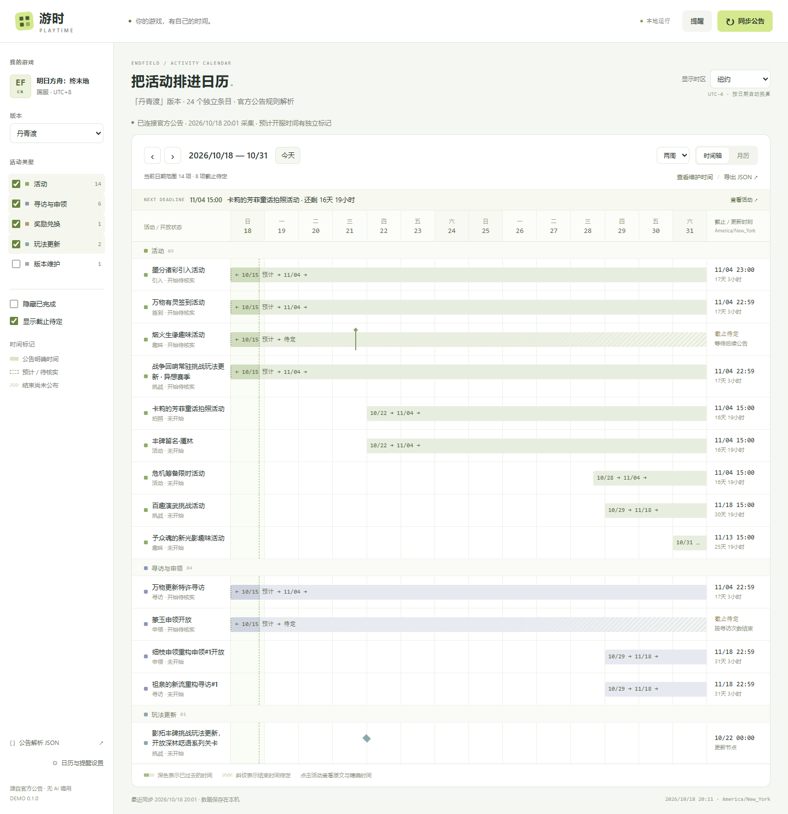
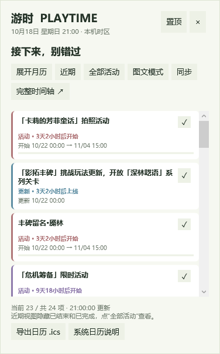

# 游时 · Playtime

当前版本：**V.0.0.1** · [更新记录](CHANGELOG.md)

本地运行的游戏活动日历 Demo。首批支持 **明日方舟：终末地国服**，通过官网公告的章节规律解析活动，不依赖 AI API、游戏账号或云端数据库。



## 启动

Windows 桌面版：双击项目根目录的 **`Playtime.cmd`**，或运行 `./start-desktop.ps1`。提供可拖动挂件、可选置顶、原生月历和托盘菜单；关闭窗口会收起到托盘，右键托盘选择“退出游时”才会结束程序。桌面端的时间跟随本机时区，网页端可另外切换显示时区。

本机已生成 `dist/desktop/Playtime.exe`；桌面端需要 .NET 10 Desktop Runtime 和 Python 3.11+。从源码首次构建需要 .NET 10 SDK，启动脚本会自动编译。详细操作、构建和系统日历边界见 [Windows 桌面版](docs/windows-desktop.md)。



以下为原有网页模式的启动方式：

界面提供“版本全览”和“全部活动”：前者将本版本已知日期铺进同一条时间轴，后者完整列出活动，不受当前日期范围限制；支持搜索及一键恢复全部筛选。月历重叠过多时也可切换完整列表查看。

联网同步会按活动名称匹配官方公告封面，缓存在本机并在时间条左端渐隐显示；未找到专属图时使用独立色标、活动类型和完整标题。当前验证的官网列表可匹配 2 个活动封面，尚未覆盖全部活动，也不使用版本通用图冒充专属头图。

需要 **Python 3.11 或更新版本**，服务端仅使用 Python 标准库，前端无需 npm 安装和构建。

Windows PowerShell，在项目目录运行：

```powershell
.\start.ps1
```

如果本机 PowerShell 禁止运行脚本，也可直接使用 Python：

```powershell
python app.py
```

macOS / Linux：

```bash
python3 app.py
```

随后打开 **http://127.0.0.1:8765**。命令行窗口保持运行，按 `Ctrl+C` 停止。

可选参数：

```powershell
.\start.ps1 -Port 8766
.\start.ps1 -Offline
```

```bash
python app.py --port 8766
python app.py --no-sync
python app.py --data-dir ./my-calendar-data
python app.py --no-desktop
```

首次启动先使用随项目附带的真实官网快照，随后自动尝试同步。离线和同步失败时保留本地数据，界面会明确显示快照来源与采集时间。

## 已实现

- 官网公开公告列表与版本更新正文采集，默认每 3 小时检查一次，也可手动同步。
- JSON 配置章节、活动标题、时间字段、类型和维护引用规则。
- 一篇版本公告拆成多个活动；奖励兑换商店单独列出截止时间。
- 时间轴、月历、跨日活动、重叠活动的当日日程和活动类型筛选。
- 当地时间与国服时间并列显示；浏览器按事件日期处理夏令时。
- 区分公告明确、预计开服、待定、手动校正和已确认开服。
- 活动内容更新节点，保留为阶段标记而非活动截止时间。
- 完成状态、备注、独立活动提醒和时间校正保存到本机 SQLite。
- 截止提醒收件箱、通知去重、近期错过截止的补查、测试提醒。
- 可选本机桌面通知和浏览器通知。
- 在界面查看、下载规则配置和结构化解析结果。

## 时间规则

公告中的精确日期直接保存为 UTC，并保留原文与国服时区依据。

- **“本版本更新后”**：关联本次维护的预计结束时间，标为“预计 / 待核实”。在“查看维护时间”中记录实际开服时刻后，相关条目一起更新。
- **“版本更新维护前”**：尚无下一次维护公告时保持待定；本地数据库收到后续版本的维护开始时间后自动关联。
- **“于 3 次特许寻访后结束”**：保留周期条件，暂不按版本长度推算日期。
- **“活动内容更新时间”**：保存为该活动的阶段节点。
- **兑换商店**：独立条目，避免与活动本身的截止日期混用。
- **没有截止的玩法更新**：作为时间节点，不生成截止提醒。

预计和待定的截止时间不会触发精确提醒。手动校正独立于采集结果，同步不会覆盖个人修改。

样例「丹青渡」公告解析为 **24 个独立日历条目**：14 个活动、6 个寻访/申领、1 个兑换商店、2 个玩法更新和 1 个维护条目。该数字属于这篇样例，不代表完整游戏活动覆盖率。

详细规则与 JSON 字段见 [公告解析设计](docs/announcement-rules.md)。

修改 `rules/endfield-cn.json` 后，重启程序并重新同步即可用于新解析。也可以完全离线验证规则，结果默认写入 `data/analysis.json`：

```bash
python analyze.py
python analyze.py --input path/to/announcement.html --cid 1234
```

## 提醒如何运行

默认提前 **24 小时和 1 小时**提醒，可调整为 3 天，也可为单个活动单独配置或关闭。

| 通道 | 要求 |
| --- | --- |
| 应用内收件箱 | 本地程序运行时检查，提醒持久保存 |
| 系统桌面提醒 | 在设置中主动开启，本地 Python 程序持续运行 |
| 浏览器提醒 | 授予通知权限，并保持网页打开 |

Windows 使用隐藏运行的系统通知图标进程；macOS 使用 `osascript`；Linux 需要可用的 `notify-send` 和桌面通知服务。无桌面环境仍可使用收件箱。系统通知受操作系统的通知设置与勿扰模式影响。

关闭网页后，本机系统通知仍可由后台 Python 程序交付。**停止程序、电脑休眠或关机期间不会检查**。重新运行后检查当前提前提醒窗口，并补查最近 6 小时内已过截止的项目。它不是系统服务，也不会擅自添加开机启动。

## 数据与目录

```text
app.py                        本地 HTTP 服务与接口
acg_calendar/
  parser.py                   章节拆分、时间解析、维护关联
  collector.py                官网采集与快照回退
  storage.py                  SQLite 与个人校正
  reminders.py                提醒调度、去重、系统通知
rules/endfield-cn.json        终末地国服规则配置
samples/                      真实官网样例和解析 JSON
web/                          无构建步骤的日历界面
tests/                        后端测试与浏览器验证
data/                         本机运行数据，已被 Git 忽略
```

本地数据库位于 `data/calendar.sqlite3`，采集到的正文位于 `data/sources/`。备份时先停止程序，再备份整个 `data/` 目录。

服务默认只绑定 `127.0.0.1`，用于个人本机运行。无需 API Key。没有遥测或用户账号体系；联网请求用于访问官方公告。

## 开发与验证

后端测试使用标准库，不访问外网：

```bash
python -m unittest discover -s tests -p "test_*.py" -v
```

浏览器验证另外需要 Node.js、Playwright 和 Edge。测试会启动独立数据库与本地端口，覆盖真实界面操作：

```bash
node tests/e2e.cjs
```

如 Python 或 Playwright 不在默认路径，可设置 `CALENDAR_PYTHON` 和 `PLAYWRIGHT_MODULE`。也可通过 `CALENDAR_TEST_URL` 指向已有的**测试实例**；此时测试会修改该实例的个人状态。

本次在 Windows 上验证了 52 项后端测试，以及浏览器中的时区/DST、维护关联、校正保存、完成标记、提醒收件箱、JSON 下载、完整列表/搜索/版本总览与 320–1440px 布局；另用真实官方封面验证了图片缓存与渐隐显示。桌面端另有隔离自检，覆盖本地服务启动、24 项活动加载、全部活动无遗漏、完成标记、日历导出、挂件/月历渲染及退出清理。Windows 系统通知进程调用成功；未在 macOS/Linux 上实际验证系统通知。

## 当前范围

这是本地 Demo：仅支持终末地国服的版本更新说明格式。每次同步检查官网列表第一页，读取其中最多两篇版本更新说明，已有版本继续保留。它尚未补抓全部历史分页，也不自动理解图片专有排期和所有独立活动公告。

网站改版或公告格式变化时，需要更新对应规则或解析器。遇到无法识别的结构会保留现有数据，并显示同步失败；单个活动的歧义可先通过手动校正解决。

代码采用 [MIT License](LICENSE)。官方公告样例、游戏名称与公告内容的权利归原权利人所有，参见 [NOTICE](NOTICE.md)。本项目与鹰角网络无隶属关系。
