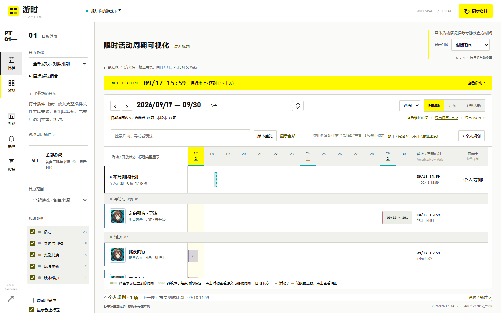
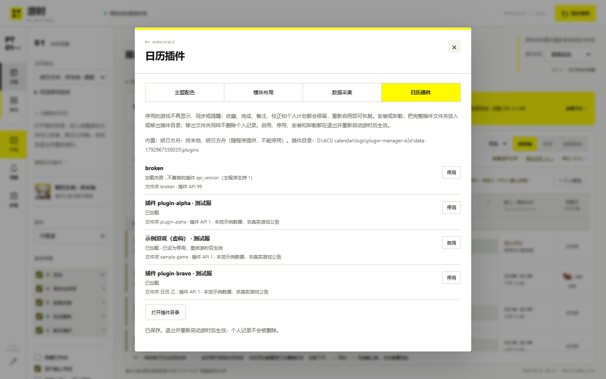
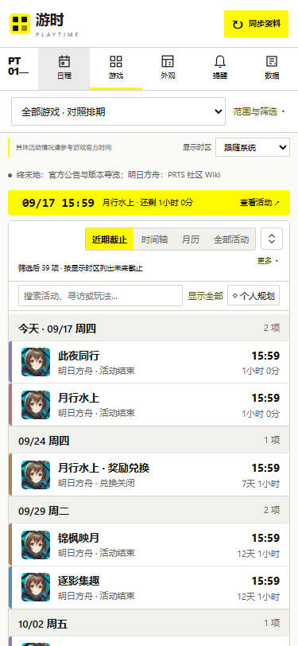
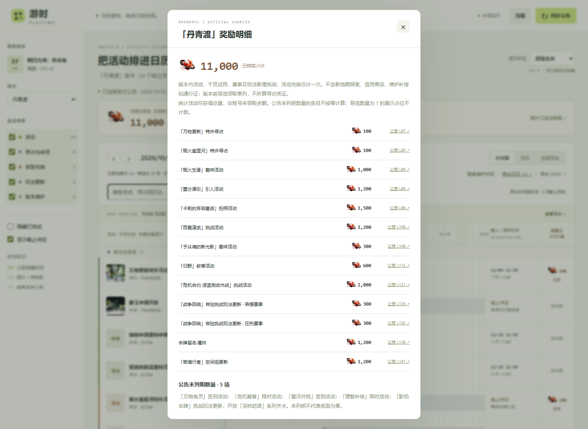

# 游时 · Playtime

当前版本：**v0.2.0** · [更新记录](CHANGELOG.md) · [待完成功能](TODO.md) · [架构说明](docs/architecture.md) · [插件接口](docs/plugins.md)

v0.2.0 新增 **个人规划拖选与总览、个人数据备份恢复、插件启停管理、独立提醒范围、手机近期截止视图**，并优化同步进度、刷新焦点、隐藏活动提示、当地时间校正及桌面靠边动画。保留模块布局、五游戏主题与统一时间线；插件 API 1 和原有活动 ID 保持兼容。详见 [更新记录](CHANGELOG.md) · [操作说明](docs/preferences.md) · [升级步骤](docs/releases/v0.2.0.md)。

自动复查默认每 24 小时后执行，另加 0–2 小时错峰；可选 18 小时。首次或离线过期补查错峰 1–10 分钟，同站请求至少间隔 10 秒。倒计时在本地运行，重启保留复查计划。

当前源码继续加入日期/游戏模块联动、主子活动折叠、截止密度和个人游玩计划层。点击日历工具栏 **◇ 个人规划** 查看全部规划及与当前时间轴重叠的活动；点击 **创建个人规划** 后可直接在时间轴上拖选时段，确认后保存。也可手动输入、编辑、移动或删除；规划以虚线条及月历标记显示，独立于官方活动日期。详见 [操作与规则](docs/planning.md)。

更新源码后，请从托盘选择“退出游时”再启动 `Playtime.cmd`；仅使用网页时停止并重新运行 `start.ps1` 或 `app.py`，让新后端与设置页面一起生效。

本地运行的游戏活动日历 Demo，现支持下列五款游戏与区服；不依赖 AI API、游戏账号或云端数据库。

| 游戏 | 区服 | 来源与接入方式 |
| --- | --- | --- |
| 明日方舟：终末地 | 国服 | 内置；官网更新公告与版本导览 |
| 明日方舟 | 国服 | 内置；PRTS 活动信息，官网补充头图 |
| 胜利女神：NIKKE | 国际服 | `nikke-global`；GameKee 活动日历与公告 |
| 碧蓝航线 | 国服 | `azurlane-cn`；BWIKI 公告，英文 Wiki 已核对头图 |
| 绝区零 | 国服 | `zzz-cn`；官网公告及头图，BWIKI 精确匹配补图 |

源码用户将所需插件安装到 `data/plugins/` 后重启；v0.2.0 Windows 包已预装三个插件。可自选任意游戏组合查看整体时间线。完整来源致谢、非商业用途与免责声明见 [开发文档](docs/development.md)。

当前源码另提供 [NIKKE 国际服插件](plugins/nikke-global/README.md)：读取用户指定的 GameKee 外服日历与更新公告，提供 Logo、头图、公告时间优先规则及离线活动 JSON。将完整插件目录安装到 `data/plugins/` 后重启启用；V0.0.7 已包含所需采集引擎和本地插件图片支持。

[碧蓝航线国服插件](plugins/azurlane-cn/README.md)通过 BWIKI 活动表发现国服公告，使用英文 Azur Lane Wiki 专题补充已核对头图，时间统一以国服公告为准；当前真实快照含 20 条活动、12 条带图。支持相同的安装方式、游戏组合、时区和提醒。

v0.2.0 新增碧蓝航线 [JSON 头图对齐与历史回测](docs/azurlane-artwork-alignment.md)：按更新批次、日期及名称/任务证据自动寻找图片，冲突时保留回退，不以外服时间替换国服时间。

无独立头图的碧蓝航线条目还可自动共用所属国服更新公告末尾的主视觉，详情标注共享来源；已用 10 月 22 日真实公告验证 5 条新记录。

[绝区零国服插件](plugins/zzz-cn/README.md)优先读取官网中文公告正文与独立活动图片，BWIKI 仅在名称和精确区间完全匹配时补图；当前快照覆盖 3.2、3.3 两个版本，共 25 条记录、23 条官方头图。“版本更新后”按对应维护公告计算并保留预计状态，不以新闻发布时间或商城下架日期推算。支持相同的本地安装、组合时间线与提醒。

左侧“日历游戏”可选择单款、全部游戏，或展开“自选游戏组合”勾选任意游戏。各游戏共用日期轴，保留区服与来源；后台提醒可选全部游戏、跟随当前组合或单独自选；普通搜索和类型筛选不改变提醒范围。网页与桌面端都从适配器注册表生成游戏选项，支持本地 JSON 数据插件。活动详情可收藏置顶；网页侧栏支持排序、分组与隐藏未开放活动，桌面端使用同一排序结果。[明日方舟与 Wiki 数据源说明](docs/wiki-sources.md)。

## 页面预览

满屏工作区与近期截止重点：



插件管理（停用与启用在重启后生效）：



手机近期截止：



展开时间轴（中央箭头或 Esc 还原）：


活动详情与独立头图：


## 启动

Windows 桌面版：双击项目根目录的 **`Playtime.cmd`**，或运行 `./start-desktop.ps1`。提供可拖动挂件、可选置顶、原生月历和托盘菜单；当前源码默认关闭后保留桌面挂件，可在外观页改为收起托盘，托盘“退出游时”才结束程序。桌面端跟随本机时区，网页端可另外切换显示时区。

桌面构建位于 `dist/desktop/build-*/Playtime.exe`，启动器自动选择最新构建；桌面端需要 .NET 10 Desktop Runtime 和 Python 3.11+。从源码首次构建需要 .NET 10 SDK，启动脚本会自动编译。详细操作、构建和系统日历边界见 [Windows 桌面版](docs/windows-desktop.md)。


以下为原有网页模式的启动方式：

界面提供“版本全览”和“全部活动”：前者将本版本已知日期铺进同一条时间轴，后者完整列出活动，不受当前日期范围限制；支持搜索及一键恢复全部筛选。月历重叠过多时也可切换完整列表查看。

终末地的联网同步会从官网新闻中发现“新版本导览”专题入口，按版本名称核对导览中的国服活动配置，并与版本更新公告合并。图片优先使用官方导览的独立素材，公告封面作为补充；缓存到本机，在时间条左端渐隐显示。当前「丹青渡」版本已关联 9 条导览配置到 10 个日历条目，合计 12 个条目有官方素材。未找到素材时使用独立色标、活动类型和完整标题。

终末地适配器只访问其官方站、官方新闻接口与限定的官方 CDN 路径。公告中的明确时间优先，导览中“维护后开放／维护前结束”的显示标记保留原义，时间冲突会列出两份依据并提示核对。导览先于更新公告发布时先缓存，等对应更新公告出现后自动关联。导览入口切换新版时会验证版本名称，保留旧版快照，避免串版。

时间轴右端使用嵌晶玉图标展示每项活动的奖励总量，顶部汇总整个版本的已核实小计，点击可查看逐笔来源。当前「丹青渡」核实为 **11,000 嵌晶玉 / 13 笔奖励**；活动商店共享奖励池只计一次，未列明数量不按零处理。新地图、信用商店不计入，维护补偿、通行证和版本维护前截止的导览网页领取另列说明。筛选和完成状态不改变版本小计。[统计口径与明细](docs/rewards.md)。



需要 **Python 3.11 或更新版本**；业务代码使用 Python 标准库，Windows 还需安装 IANA 时区数据：`python -m pip install -r requirements.txt`。前端无需 npm 安装和构建。

Windows PowerShell，在项目目录运行：

```powershell
.\start.ps1
```

如果本机 PowerShell 禁止运行脚本，也可直接使用 Python：

```powershell
python app.py
```

macOS / Linux：

```bash
python3 app.py
```

随后打开 **http://127.0.0.1:8765**。命令行窗口保持运行，按 `Ctrl+C` 停止。

可选参数：

```powershell
.\start.ps1 -Port 8766
.\start.ps1 -Offline
```

```bash
python app.py --port 8766
python app.py --no-sync
python app.py --data-dir ./my-calendar-data
python app.py --no-desktop
```

首次启动先使用随项目附带的真实官网快照，随后自动尝试同步。离线和同步失败时保留本地数据，界面会明确显示快照来源与采集时间。

## 已实现

- 官网公开公告列表与版本更新正文采集，当前源码默认每 24 小时后检查一次，另加 0–2 小时随机错峰，也可手动同步。
- JSON 配置章节、活动标题、时间字段、类型和维护引用规则。
- 一篇版本公告拆成多个活动；奖励兑换商店单独列出截止时间。
- 时间轴、月历、跨日活动、重叠活动的当日日程和活动类型筛选。
- 当地时间与国服时间并列显示；浏览器按事件日期处理夏令时。
- 区分公告明确、预计开服、待定、手动校正和已确认开服。
- 活动内容更新节点，保留为阶段标记而非活动截止时间。
- 完成状态、备注、独立活动提醒和时间校正保存到本机 SQLite。
- 截止提醒收件箱、通知去重、近期错过截止的补查、测试提醒。
- 可选本机桌面通知和浏览器通知。
- 在界面查看、下载规则配置和结构化解析结果。

## 时间规则

公告中的精确日期直接保存为 UTC，并保留原文与国服时区依据。

- **“本版本更新后”**：关联本次维护的预计结束时间，标为“预计 / 待核实”。在“查看维护时间”中记录实际开服时刻后，相关条目一起更新。
- **“版本更新维护前”**：尚无下一次维护公告时保持待定；本地数据库收到后续版本的维护开始时间后自动关联。
- **已给出维护日期、未给具体时刻的截止**：按用户指定暂定为该日区服时间 10:00，并标为预计；明确维护公告优先。没有维护日期仍保持待定。所有活动详情和页面右上角提示“具体活动情况请参考游戏官方时间”。
- **“于 3 次特许寻访后结束”**：保留周期条件，暂不按版本长度推算日期。
- **“活动内容更新时间”**：保存为该活动的阶段节点。
- **兑换商店**：独立条目，避免与活动本身的截止日期混用。
- **没有截止的玩法更新**：作为时间节点，不生成截止提醒。

预计和待定的截止时间不会触发精确提醒。手动校正独立于采集结果，同步不会覆盖个人修改。

样例「丹青渡」公告解析为 **24 个独立日历条目**：14 个活动、6 个寻访/申领、1 个兑换商店、2 个玩法更新和 1 个维护条目。该数字属于这篇样例，不代表完整游戏活动覆盖率。

详细规则与 JSON 字段见 [公告解析设计](docs/announcement-rules.md)。

修改 `rules/endfield-cn.json` 后，重启程序并重新同步即可用于新解析。也可以完全离线验证规则，结果默认写入 `data/analysis.json`：

```bash
python analyze.py
python analyze.py --input path/to/announcement.html --cid 1234
```

## 提醒如何运行

默认提前 **24 小时和 1 小时**提醒，可调整为 3 天，也可为单个活动单独配置或关闭。

“提醒与收件箱”中可选择提醒哪些游戏：全部已安装游戏（默认，含以后安装的）、跟随当前游戏组合，或自选游戏。提醒范围不受页面搜索、类型和日期筛选影响；网页和桌面使用同一设置。

| 通道 | 要求 |
| --- | --- |
| 应用内收件箱 | 本地程序运行时检查，提醒持久保存 |
| 系统桌面提醒 | 在设置中主动开启，本地 Python 程序持续运行 |
| 浏览器提醒 | 授予通知权限，并保持网页打开 |

Windows 使用隐藏运行的系统通知图标进程；macOS 使用 `osascript`；Linux 需要可用的 `notify-send` 和桌面通知服务。无桌面环境仍可使用收件箱。系统通知受操作系统的通知设置与勿扰模式影响。

关闭网页后，本机系统通知仍可由后台 Python 程序交付。**停止程序、电脑休眠或关机期间不会检查**。重新运行后检查当前提前提醒窗口，并补查最近 6 小时内已过截止的项目。它不是系统服务，也不会擅自添加开机启动。

## 数据与目录

```text
app.py                        本地 HTTP 服务与接口
acg_calendar/
  parser.py                   章节拆分、时间解析、维护关联
  collector.py                官网采集与快照回退
  storage.py                  SQLite 与个人校正
  reminders.py                提醒调度、去重、系统通知
  rewards.py                  嵌晶玉来源、共享奖励去重与版本小计
rules/endfield-cn.json        终末地国服规则配置
samples/                      真实官网样例和解析 JSON
web/                          无构建步骤的日历界面
tests/                        后端测试与浏览器验证
data/                         本机运行数据，已被 Git 忽略
```

本地数据库位于 `data/calendar.sqlite3`，采集到的正文位于 `data/sources/`。备份时先停止程序，再备份整个 `data/` 目录。

服务默认只绑定 `127.0.0.1`，用于个人本机运行。无需 API Key。没有遥测或用户账号体系；联网请求用于访问对应游戏的官方公告和用户指定的 Wiki 来源。

## 开发与验证

后端测试使用标准库，不访问外网：

```bash
python -m unittest discover -s tests -p "test_*.py" -v
```

浏览器验证另外需要 Node.js、Playwright 和 Edge。测试会启动独立数据库与本地端口，覆盖真实界面操作：

```bash
node tests/e2e.cjs
node tests/e2e-multigame.cjs
node tests/e2e-architecture.cjs
node tests/e2e-nikke.cjs
node tests/e2e-azurlane.cjs
node tests/e2e-zzz.cjs
```

如 Python 或 Playwright 不在默认路径，可设置 `CALENDAR_PYTHON` 和 `PLAYWRIGHT_MODULE`。也可通过 `CALENDAR_TEST_URL` 指向已有的**测试实例**；此时测试会修改该实例的个人状态。

架构升级在 Windows 上验证了 129 项后端测试，以及浏览器中的时区/DST、维护关联、校正保存、完成标记、提醒收件箱、JSON 下载、完整列表/搜索/版本总览与 320–1920px 布局；另用真实官方封面验证了图片缓存与渐隐显示。明日方舟官网实测读取 5 篇公告，现有 15 条本地记录中 14 条匹配了活动/寻访横幅（含共用主活动图的兑换条目），这不是全游戏覆盖率。两款游戏的左侧方形标识、边线颜色与游戏名称在网页及桌面端保持一致。桌面端另有隔离自检，覆盖本地服务启动、两款真实游戏加虚构插件共 40 条测试条目加载、任意游戏组合、11,000 玉奖励汇总与图标、全部活动无遗漏、完成标记、日历导出、挂件/月历渲染及退出清理。Windows 系统通知进程调用成功；未在 macOS/Linux 上实际验证系统通知。

## 当前范围

当前提供插件 API 1、模块布局与主题编辑器、个人计划拖选/编辑/时间条、日期聚焦、截止密度、备份恢复及插件启停。手动校正和实际开服时间按当前显示时区输入，服务端处理夏令时后以 UTC 保存。Windows 系统时钟面板直接接入、免重启插件重载及桌面原生备份/插件管理仍属后续范围，见 [待办状态](TODO.md)。本地 JSON 插件不会执行任意网站抓取代码。

这是本地 Demo：支持终末地国服的版本更新说明与官方新版本导览，以及明日方舟国服的 PRTS 活动条目。以下新闻扫描数量适用于终末地；PRTS 范围详见 Wiki 数据源说明。每次同步最多检查官网列表 3 页，每页 20 条，解析其中最多两篇更新说明并发现最多三篇导览新闻，已有版本继续保留。导览配置按版本缓存；版名不符、结构变化、图片下载失败时保留已有日历，并记录具体原因。尚不自动理解图片专有排期和所有独立活动公告，也不把未关联到更新公告的常驻玩法启动时间当作当期新活动。

网站改版或公告格式变化时，需要更新对应规则或解析器。遇到无法识别的结构会保留现有数据，并显示同步失败；单个活动的歧义可先通过手动校正解决。

本项目以个人非商业学习、研究与本地时间规划为目的。源码采用 [MIT License](LICENSE)；此用途声明不修改 MIT，也不授予第三方内容的商业使用权。游戏公告、图片、商标与 Wiki 内容须遵守各自来源许可，参见 [NOTICE](NOTICE.md) 和 [网站致谢、非商业用途与免责声明](docs/development.md)。具体活动情况请参考游戏官方时间。
