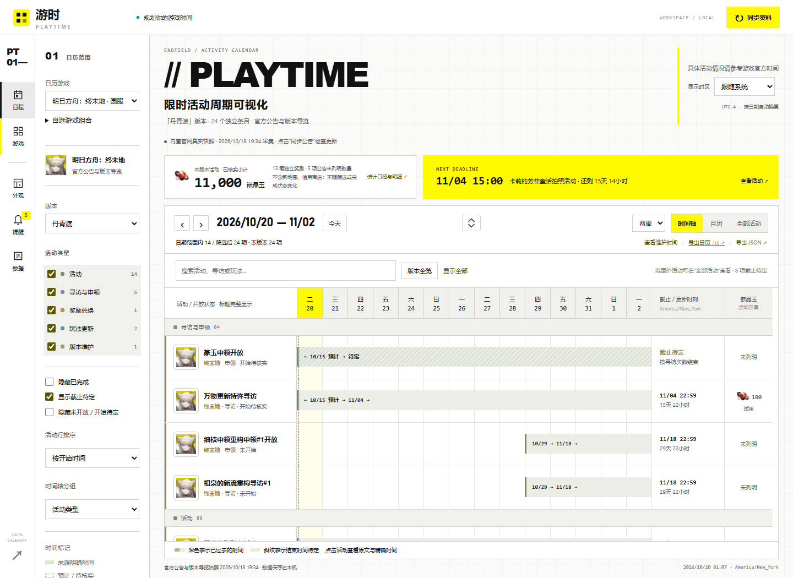
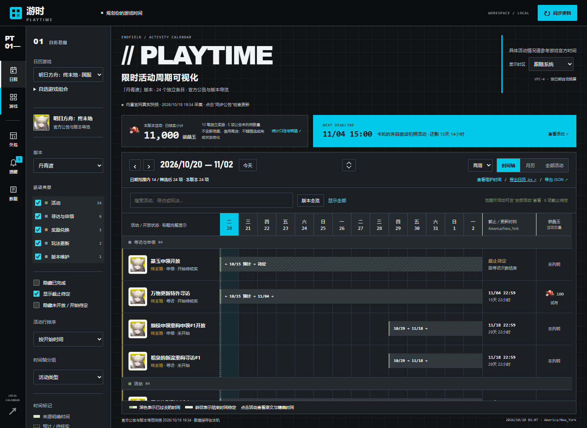
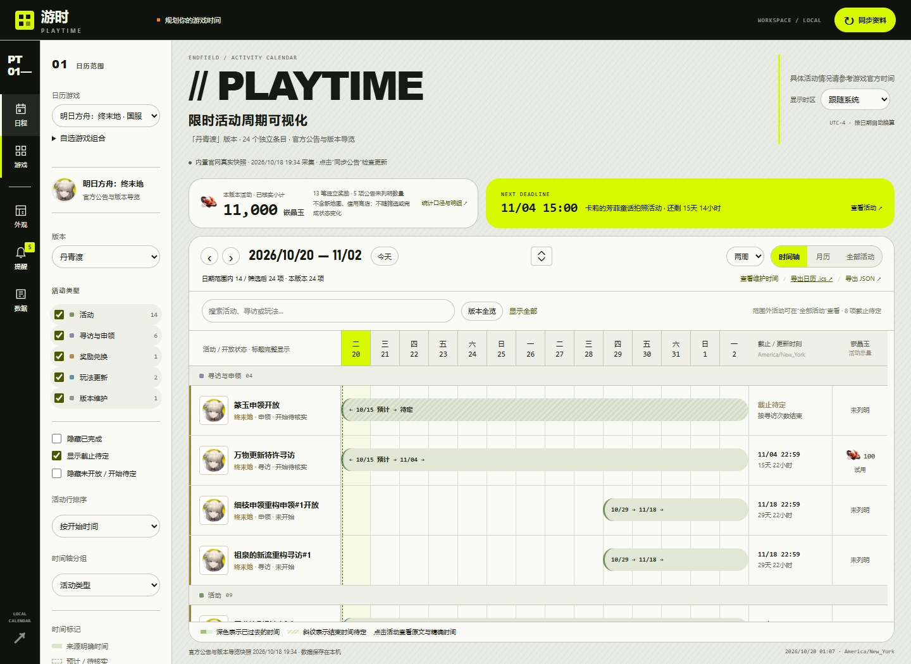
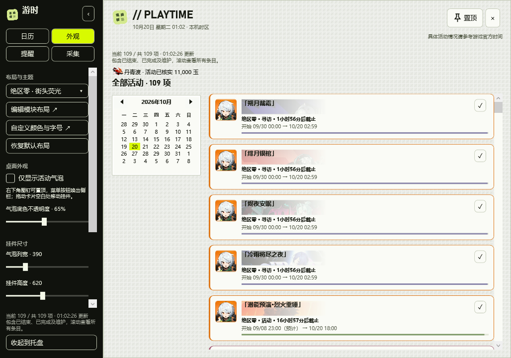

# 工业日历设计体系（v0.1.0）

## 参考与提炼

参考 [终末地官网](https://endfield.hypergryph.com/)，以及用户提供的明日方舟、绝区零官网截图。终末地可见页面的主要元素：白底、重黑大字、窄竖向导航、亮黄强调块（可见 DOM 为 `#FFFA00`）、硬边与编号/斜线标记。这里提炼其版式和色彩角色，使用软件自己的名称、系统字体和代码绘制图形。

## 转化为日历的结构

- **工具轨道**：日程、游戏筛选显隐、外观、提醒、数据；固定位置，图标附短文字和可访问名称。
- **筛选栏**：只承担游戏、版本、活动类型、状态和排序。高级规则按需展开，不占主要工具位置；支持左右位置与隐藏。
- **工作区**：黑色重标题确定页面身份，紧凑的奖励/最近截止概览共享一行，随后进入日历。最近截止整块使用主题强调色作为视觉重点；强调色也用于操作和当天定位；活动类型与游戏图标继续承担分类。
- **长时间轴**：工作区铺满视口，不留居中宽度限制带来的空白，也不整页滚动；日历自动占满剩余高度。工具栏中央箭头可临时收起周边界面，再次点击或 Esc 还原；不更改保存的布局和筛选。限定内部滚动区域，日期表头固定，活动名称列横向滚动时固定，避免离开标题后失去对照。月历、全部活动、搜索、维护和导出保留。
- **窄屏**：工具轨道变为横向导航，游戏/版本保留直达，类型/状态/排序收为可展开区，概览单列、时间轴内部滚动；支持减少动态效果偏好。

桌面端采用同一语义配色、字重与纹理，气泡与按钮圆角使用独立值。左上角软件标识使用固定形状，不随面板或控件圆角变化。保留四类侧栏、右下角挂件工具条、透明间隙穿透、关闭常驻和靠边唤出。原生选择器显示名称，滑块使用清晰的轨道与滑块；日期控件保留其原生结构。

## 同一骨架的三种风格

| 预设 | 颜色关系 | 几何与图形 |
| --- | --- | --- |
| 终末地 · 工业白黄 | 白/浅灰大面积，黑正文，亮黄块配黑字 | 面板/控件圆角 0，重标题，低强度工程网格 |
| 明日方舟 · 战术黑青 | 黑灰背景、灰白字、青色定位 | 面板圆角 0、控件圆角 2，细网格与紧凑数据排版 |
| 绝区零 · 街头荧光 | 黑导航、灰白工作区、荧光绿与橙辅助 | 网页面板圆角 22、控件圆角 32；桌面气泡 8、按钮 6；粗标题和低强度斜线 |

“标准 · 游时”使用简洁工业白底，圆角 4/2、无纹理；深色、NIKKE 和碧蓝航线预设继续可选。游戏皮肤可用于任何游戏组合，与数据接入分离。

## 自定义范围

19 个颜色令牌分为四类用途：

| 角色 | 字段 |
| --- | --- |
| 表面与文字 | `background / surface / panel_alt / text / muted / border` |
| 强调与导航 | `accent / accent_text / secondary / link / nav_background / nav_text` |
| 时间条 | `bar_background / bar_text` |
| 活动类型 | `event_color / gacha_color / exchange_color / update_color / maintenance_color` |

几何与排版另有网页面板圆角 0–28、控件圆角 0–40，桌面气泡圆角 0–16、按钮圆角 0–12（字段 `desktop_radius / desktop_control_radius`）、字号 12–18、标题字重 600–900、间距 8–24、边框 0–2、纹理类型（无/网格/斜线/点阵）与强度 0–12%、底色不透明度 35%–100%。编辑器按用途折叠分组，预览同时呈现导航、强调块和时间条。

强调色允许亮黄/荧光绿，**只按其上方文字颜色校验**，不强迫色块与白底达到文字对比度。正文/表面、导航字/导航底、时间条字/时间条底、强调块字/强调块均检查；链接单独配置，避免把黄字放到白底。颜色大小写统一，未改动预设不会被误标为自定义。

## 兼容与验证

插件 API 1、manifest 和活动 JSON 无改动；主题继续使用 schema 1，新增令牌有默认值。旧主题缺少桌面圆角字段时补齐对应预设的桌面值，保留原有网页圆角。布局的旧 `max_width` 保留兼容，但不再限制网页宽度。旧的未修改工厂皮肤升级到对应新版；旧自定义主题保留已有颜色、字号和透明度，再补全导航与时间条等角色。旧 JSON 主题仍可导入，布局、收藏、个人计划和提醒配置不随换肤重置。

后端新增主题迁移、语义对比度与旧导入回归；浏览器检查三种皮肤、固定日期表头、筛选栏恢复、主题导入导出与窄屏；桌面检查三种皮肤、原生控件、透明气泡和窗口交互。截图使用隔离数据，不包含个人笔记。
