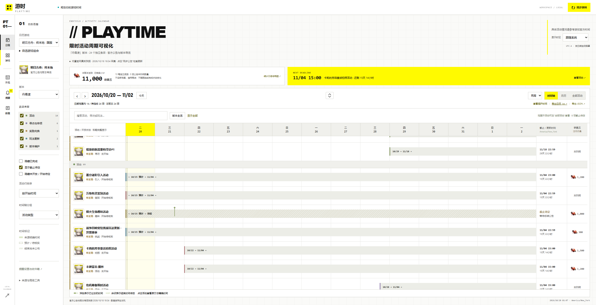
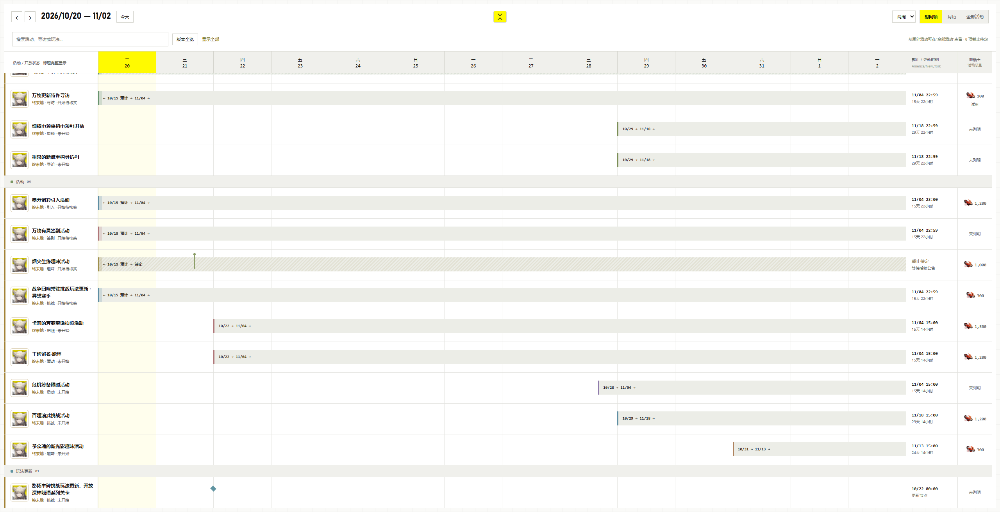
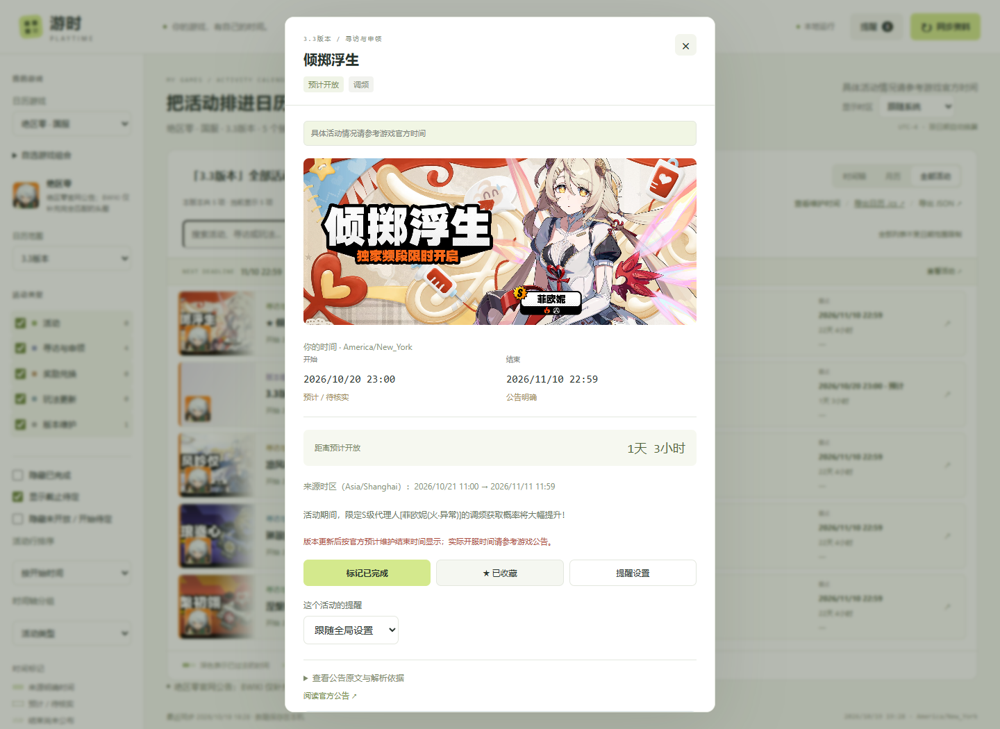
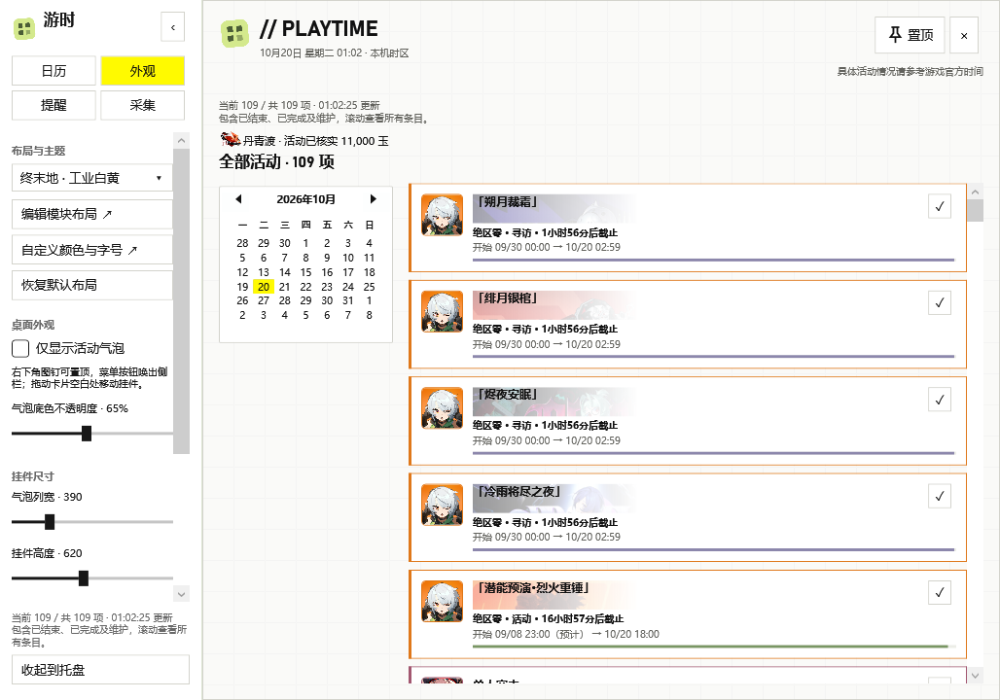

# 开发文档 · v0.1.0

本项目“游时 Playtime”是可本地部署的游戏活动日历，由来源适配器读取公开活动信息，转换为 JSON 并交给统一的时间轴、日历和提醒系统。不依赖 AI API 或游戏账号。架构见 [architecture.md](architecture.md)，插件接口见 [plugins.md](plugins.md)，后续工作见 [TODO](../TODO.md)。

v0.1.0 新增统一采集限制器、模块化布局编辑器与网页/WPF 共享主题；操作与边界见 [preferences.md](preferences.md)。

当前视觉体系进一步参考终末地官网及用户提供的其他官网截图，形成工具轨道/筛选/日历三层结构，提供工业白黄、战术黑青与街头荧光等皮肤，设计提炼、语义令牌及新实图见 [design-system.md](design-system.md)。

## 已支持的游戏与区服

| 游戏 | 区服 | 接入方式 | 当前使用的信息来源 |
| --- | --- | --- | --- |
| 明日方舟：终末地 | 国服 | 内置适配器 | 官网版本更新公告、新版本导览专题及其公开素材 |
| 明日方舟 | 国服 | 内置适配器 | PRTS Wiki 活动模板与公告；官网活动/寻访头图 |
| 胜利女神：NIKKE | 国际服 | `nikke-global` JSON 插件 + GameKee 引擎 | GameKee 对应区服活动日历和公告 |
| 碧蓝航线 | 国服 | `azurlane-cn` JSON 插件 + BWIKI 引擎 | BWIKI 国服改建公告；Azur Lane Wiki 已核对头图 |
| 绝区零 | 国服 | `zzz-cn` JSON 插件 + 官网引擎 | 官网中文公告和头图；BWIKI 精确匹配补图 |

三个插件目录随源码提供，安装至实际数据目录的 `plugins/` 后重启启用。Windows 发布包在首次运行时已提供三个插件，形成五游戏组合；升级时请保留已有个人数据，不用发布包中的数据覆盖旧数据库。

## 信息来源与感谢

感谢下列官方网站、Wiki 维护者、攻略作者、社区编辑者和素材贡献者公开整理活动信息。来源链接、原文依据和已获取的页面修订随适配器与 JSON 保留；引用不表示这些网站或游戏官方认可、授权或赞助本项目。

| 网站 / 团队 | 使用内容及说明 |
| --- | --- |
| [《明日方舟：终末地》官网](https://endfield.hypergryph.com/) · [版本导览](https://endfield.hypergryph.com/version_briefing/latest?source_from=official) | 国服更新公告、维护时间、活动与奖励字段、官方导览及头图。感谢鹰角网络及相关公告与美术制作团队。 |
| [《明日方舟》官网](https://ak.hypergryph.com/#information) | 按对应公告章节匹配活动、寻访图片。感谢官方运营与素材制作团队。 |
| [PRTS Wiki](https://prts.wiki/w/首页) · [活动一览](https://prts.wiki/w/活动一览) | 明日方舟国服结构化活动信息、兑换截止及公告依据。感谢 PRTS 编辑与维护者。 |
| [GameKee NIKKE 国际服活动日历](https://www.gamekee.com/nikke/huodong/19) | 国际服活动卡、公告整理、日期与对应头图。感谢 GameKee 与 NIKKE Wiki 社区贡献者；这是社区来源，不标为游戏官方。 |
| [哔哩哔哩游戏 Wiki / 碧蓝海事局](https://wiki.biligame.com/blhx/游戏活动表) | 碧蓝航线国服改建公告、活动时间与部分图片，以及小活动任务/奖励表研究。感谢 BWIKI 平台、碧蓝海事局与相关编辑者。 |
| [Azur Lane Wiki](https://azurlane.koumakan.jp/wiki/Recent_News) | 碧蓝航线英文活动专题与已核对头图、跨语言任务表研究。感谢该 Wiki 编辑与维护者；英文区服日期不用于国服排期。 |
| [《绝区零》官网](https://zenless.hoyoverse.com/zh-cn/news?category=296) | 中文公告正文、版本维护安排、活动时间和独立调频图片。感谢米哈游 / HoYoverse 及相关公告与美术制作团队。 |
| [哔哩哔哩游戏 Wiki / 绝区零](https://wiki.biligame.com/zzz/活动一览) | 活动目录与图片匹配参考。感谢 BWIKI 与绝区零 Wiki 编辑者；目录可能滞后，不替代官方排期。 |
| 官方与 Wiki 媒体服务 | `web.hycdn.cn`、`media.prts.wiki`、`cdnimg-v2.gamekee.com`、`patchwiki.biligame.com`、`azurlane.netojuu.com`、`fastcdn.hoyoverse.com` 等提供对应页面引用的公开图片；素材权利仍归各自权利人。 |

另感谢用户提供游戏 APP 图标、嵌晶玉图标及界面参考。现有素材的具体来源与许可见根目录 [NOTICE](../NOTICE.md) 和各插件 README / sources / rules 文件。

### 已调研但不作为当前活动排期来源的网站

- [森空岛终末地官方 Wiki](https://wiki.skland.com/endfield/catalog?mainTypeId=1&subTypeId=9&filterIds=&header=0)：当前只检查公开目录的可用性；设备校验失败时保留原日历，不绕过验证，未参与活动时间与奖励统计。
- [EndSync 活动页](https://endsync.vercel.app/zh/events/)：讨论和调研过其展示方案；未将其数据或素材接入当前插件。
- [Azur Lane EN 官方 X](https://x.com/AzurLane_EN)：讨论过作为图片候选来源；当前未接入 X API，不索取账号或绕过访问限制。

## 非商业用途与第三方许可声明

游时以个人非商业学习、研究和本地时间规划为目的开发与维护。项目维护者不通过本项目出售游戏数据或素材，不提供付费代抓取服务，也不代表任何游戏运营方或信息网站。

源码沿用仓库现有 [MIT License](../LICENSE)。上述项目用途声明不是对 MIT 增设“禁止商业使用”条款，也不会把第三方公告、图片、商标或 Wiki 内容变成 MIT 授权素材。使用者须分别遵守源站规则与第三方许可；来源标注为 CC BY-NC-SA 等非商业许可的内容，其非商业、署名及相同方式共享要求继续适用，不得把仓库开源理解为已获得第三方商业使用授权。

官方游戏名称、商标、角色、美术素材和公告内容归相关权利人所有；社区编辑内容由各来源声明的许可约束。未发现明确再分发授权的素材，不因本声明获得额外授权。保留来源及版权标识；如权利人对仓库引用或分发范围有异议，可通过[仓库 Issues](https://github.com/ZhenyuFu039/acg-calendar/issues)联系维护者处理，包括调整或移除相关内容。

## 免责与使用边界

- 本项目独立开发，与鹰角网络、米哈游 / HoYoverse、NIKKE 或碧蓝航线相关开发/发行方，以及 PRTS、GameKee、BWIKI、Azur Lane Wiki 等无隶属、合作或背书关系。
- 数据来自公开页面及社区整理，可能出现更新延迟、区服差异、页面改版、解析错误、图片失配或维护时间变更。日期、奖励与活动条件以游戏内及游戏官方最新公告为准；软件保留来源、预计与待定标记。
- 提醒依赖本地程序运行、系统时间、通知权限及本机环境，不能保证所有提醒均准时送达；不要将本工具作为避免活动过期的唯一依据。
- 软件按现状提供，适用仓库许可中的保证与责任条款；不承诺源站持续可用、活动全覆盖或自动解析完全准确。请备份本地个人数据并核对重要截止日期。
- 使用公开接口不等于可以无限制采集。请求必须遵守源站规则、访问限制及合理负载；不应绕过登录、验证码、反爬限制或付费访问控制。v0.1.0 已增加同实例跨适配器共享的间隔、配额、缓存、退避和暂停，不能代替源站许可或协调独立外部采集程序。

## 本版实现边界

v0.1.0 包含五游戏元数据、区服独立同步、JSON 插件图片、组合时间线、活动收藏/筛选、时区与夏令时换算，以及已有桌面侧栏和透明气泡模式。本版已完成模块布局与主题编辑器、满屏工作区与日历展开模式。碧蓝航线仍使用人工核对的头图映射；任务表自动匹配仅完成单例原型验证，不列为已完成。Windows 系统时钟面板直接接入、个人计划编辑器/时间条与跨模块聚焦仍待制作。

## 当前页面

以下截图来自隔离测试数据，不包含个人笔记或账号信息。

