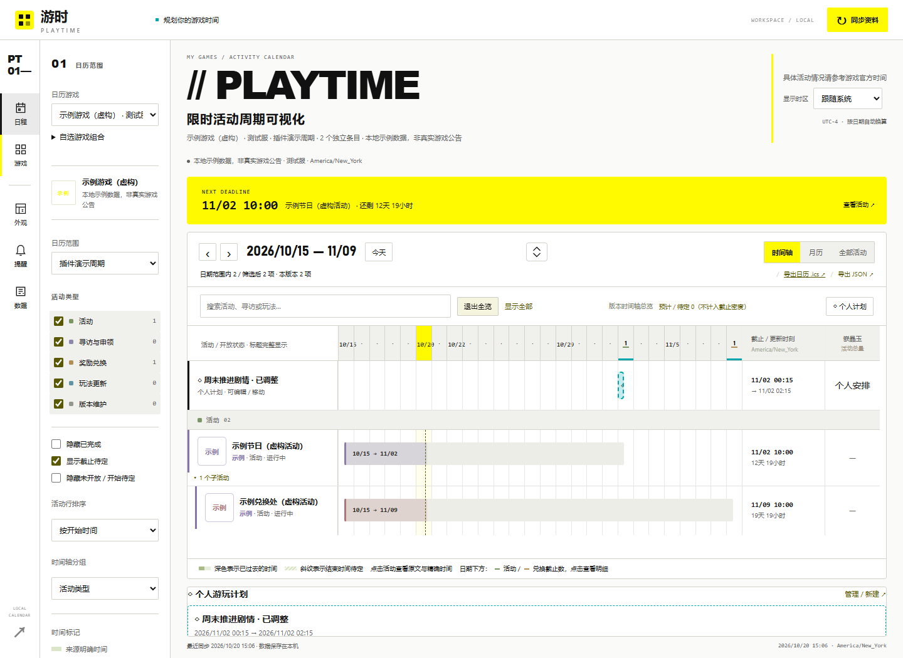
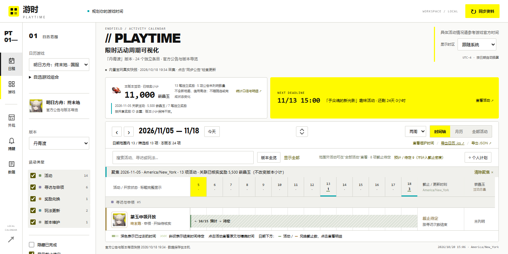
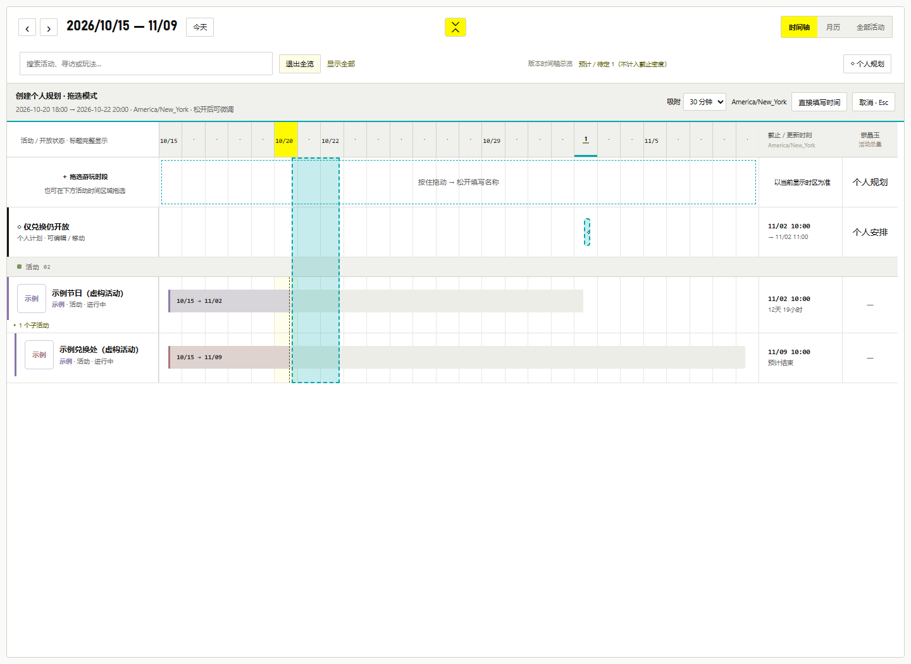
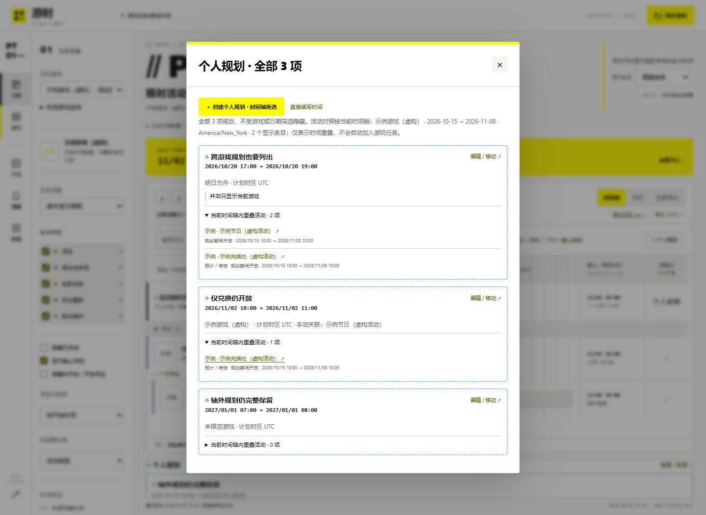

# 日期联动、活动分组与个人计划

以下功能已包含在 v0.2.0。更新后需退出托盘中的旧程序并重新启动；网页服务也需重启。插件 `api_version: 1` 与已有活动 JSON 格式保持兼容。

## 查看同一天的安排

点击时间轴日期或月历日期：活动范围、完整列表、近期截止、个人计划以及关联奖励同步聚焦这一天。日历工具栏下面显示日期、聚焦时区和活动数；点击 **清除聚焦** 恢复原游戏范围。“显示全部”也会清除聚焦并恢复筛选。

选择游戏或自选组合会作用于全部模块。时间轴与完整列表上的游戏图标也可切换游戏；键盘用户可使用左侧游戏选择框。点击活动打开详情并高亮该活动，其余日期内活动仍可查看。游戏选择与日期/活动聚焦保存在工作区，同一本地服务的网页和桌面刷新后共享；两端分别每 10 / 15 秒读取本机数据，不访问源站。

日期按所选 IANA 时区的当地午夜至下一天午夜计算，采用左闭右开的区间；夏令时日可能为 23 或 25 小时。结束恰好是当天 00:00 的活动不算当天仍开放，但仍出现在当天的截止节点明细。聚焦状态带时区，避免在不同客户端上被悄悄解释成另一个时间段。网页更换显示时区后，将当前聚焦日期按新的显示时区重新解释。

奖励卡继续保留整个版本的已核实小计；日期聚焦时另显示“关联活动奖励”，按共享奖励 ID 去重，包含兑换子项引用的共享奖励池。这个数字是关联活动的奖励总量，不代表当天能领取的数量或账号余额；未列明数量不当作零。

## 折叠主活动

有明确子项或阶段的活动旁显示 **▾ 子活动 / 阶段**，点击可折叠或展开，重启保留。子项缩进展示并继承主活动的分组；各自保留原始标题、身份、时间条和截止。

- 只接受插件显式 `parent_id`，或内置采集器在同游戏、同版本内唯一且完全匹配的 `parent_title`。相似名称不自动合并；循环关系不参与显示。
- 收藏优先开启时，已收藏子项提升到收藏区，不受父活动折叠隐藏。筛选隐藏父项时，符合筛选的子项独立展示。
- 折叠摘要分别列出活动关闭、兑换关闭和已确认的阶段关闭；预计/待定截止仍保留说明，不将兑换结束日期延长为主活动开放日期。
- 折叠只控制时间轴/列表的行展开；不改变月历、当天活动明细、截止密度、奖励或提醒。

## 截止密度

时间轴日期下方的小数字表示未完成的明确截止数：活动与兑换分别标记，鼠标悬停或辅助名称可读完整数量。月历右上角也显示截止数。点击日期可打开截止明细，并同时聚焦当天。工具栏单独显示预计/待定数量；其不进入精确截止统计。

统计先采用当前游戏、版本及显示筛选，再按 **活动 ID + UTC 时刻** 去重；同一事件的活动结束与同一时刻的结束阶段不重复计算，不同时刻的阶段关闭各算一个节点。仅 `exact / confirmed / manual` 状态参与；完成、忽略、无效区间及单次更新点不参加。折叠行不减少统计。密度表示截止数量，不推算游玩时长。

桌面普通窗口上方提供接下来 7 个有截止的日期按钮，按本机时区显示；点击后聚焦并列出具体截止项，可继续打开详情。月历日期的提示也包含截止与个人计划数量。透明气泡模式沿用精简显示。

## 创建与修改个人计划

1. 点击工具栏 **◇ 个人规划**，先查看所有已保存的规划明细，包括其他游戏和当前日期范围以外的规划。每条列出起止时间、游戏、计划时区、备注，以及与**当前时间轴显示的活动**重叠的列表。活动按当前日期、游戏、筛选和折叠状态计算；手动关联单独标注，不自动把重叠活动加入任务。
2. 点击 **创建个人规划 · 时间轴拖选** 才开启拖选工具。界面自动切换并展开时间轴；可从专用空白规划行、日期轴或活动条所在区域，按住并向左/右拖出时段。吸附可选 30 分钟、1 小时或 1 天；选择预览显示当地起止时间与时区。平时不显示拖选行，也不拦截正常点击或滚动。
3. 松开鼠标后生成草稿，填写名称即可确认保存；可在表单中进一步按分钟微调时间、选择 IANA 时区、关联游戏/活动和填写备注。拖动本身不写数据库。按 **取消 / Esc** 退出拖选并恢复先前的展开状态；也可选择 **直接填写时间**，键盘操作无需拖动。活动详情和当日日程原有的安排入口继续保留。
4. 保存后，时间轴使用虚线时间条展示，月历显示 **◇ 计划 N** 标记，个人计划模块显示起止时间。点击这些条目可编辑。
5. 编辑器可将整段计划前移/后移 1 小时或 24 小时，并保持实际持续时长；移动会保存当前输入。删除入口内有明确的“确认删除这条个人计划”按钮。

活动对照按真实时刻的区间交集计算，结束时刻相接不算重叠；单次更新只在更新时间落入规划内时列出。主子活动折叠或类型/游戏筛选隐藏的条目不会混入“当前时间轴”列表。预计/待定活动保留不确定标记；重叠不代表活动一定能完成，也不推断游玩耗时。没有匹配活动或规划超出当前范围时，规划仍完整显示。

拖选使用页面显示时区的钟面坐标，在保存时再进行 UTC 与夏令时校验；重复时刻仍需在表单中选择较早/较晚一次。后台轮询不会打断正在进行的拖选；其他窗口改变日期/游戏范围时，取消未完成的拖选并提示重选。拖选模式不持久化，刷新后关闭。明细轮询保留阅读位置与折叠状态。

移动按实际经过时间计算；跨夏令时的 24 小时不一定等于相同钟面时间的下一天。输入不存在的当地时间会被拒绝；重复时间需选择较早或较晚一次，不会默默猜测偏移。已有计划按其时区显示在编辑器中；日历和时间轴统一按页面显示时区换算。

时间轴、月历和个人计划模块中，未关联游戏的计划出现在任意游戏组合中；关联游戏的计划只在包含该游戏的范围显示，日期聚焦也同时筛选计划。**个人规划总览始终列出全部记录**，这些显示筛选不会把明细藏起来。个人计划不受官方活动类型、完成或未开放筛选影响。编辑器草稿不会被后台轮询覆盖。未关联的计划可完全独立使用；来源消失或插件卸载后，已有计划与关联 ID 保留，仍可修改或删除。

桌面日历侧栏提供 **个人计划 · 新建 / 编辑**；个人计划模块显示日期、进度条及编辑入口，编辑使用同一本地服务的网页编辑器。来源同步、官方活动改期不会移动个人计划，也不会把计划日期写回公告。

个人计划暂未加入重复规则、提醒、重叠警告或 ICS 导出。原有活动提醒继续运行，不受页面聚焦、折叠或个人计划影响。

## 开发接口

`view` 在工作区 schema 1 内新增可选 `collapsed_parents`、`focus_timezone`，旧数据自动补齐。焦点 PATCH 支持单独更新 `date` 或 `event_id`；切换游戏在服务端清除活动选择并保留最新日期，避免旧响应覆盖另一端的选择。`/api/state.presentation` 与 `/api/timeline.presentation` 提供 `parents / children / deadline_nodes / uncertain_deadlines / focus_bounds`。源事件保持原样，关联分析由主程序完成。

`POST /api/plans` 与 `PATCH /api/plans/<id>` 继续接受 UTC `start / end`；新增 `local_start / local_end / timezone / fold_start / fold_end` 输入，重复时刻 `fold` 为 0 或 1，缺省时要求明确选择。当地时间格式为 `YYYY-MM-DDTHH:mm`，同一端点不能同时提供 UTC 和当地时间。`PATCH` 可附 `move_minutes` 整段移动已保存计划。控制字段不写入计划实体；范围及关联错误返回 400，写入失败保留原计划。

计划读改写由本机存储锁保护；数据持久化在原 `personal_plans` 表，既不升级插件 API，也不新增远程服务或 AI 调用。`plan-drawing.js` 只管理临时手势与草稿，活动交集由 `planner.js` 使用主程序的当前可见条目计算，不写入来源数据。新增测试见 `tests/test_presentation.py`、`tests/e2e-planner.cjs`、`tests/e2e-plan-drawing.cjs` 和桌面 `PlannerSmokeTest`。
