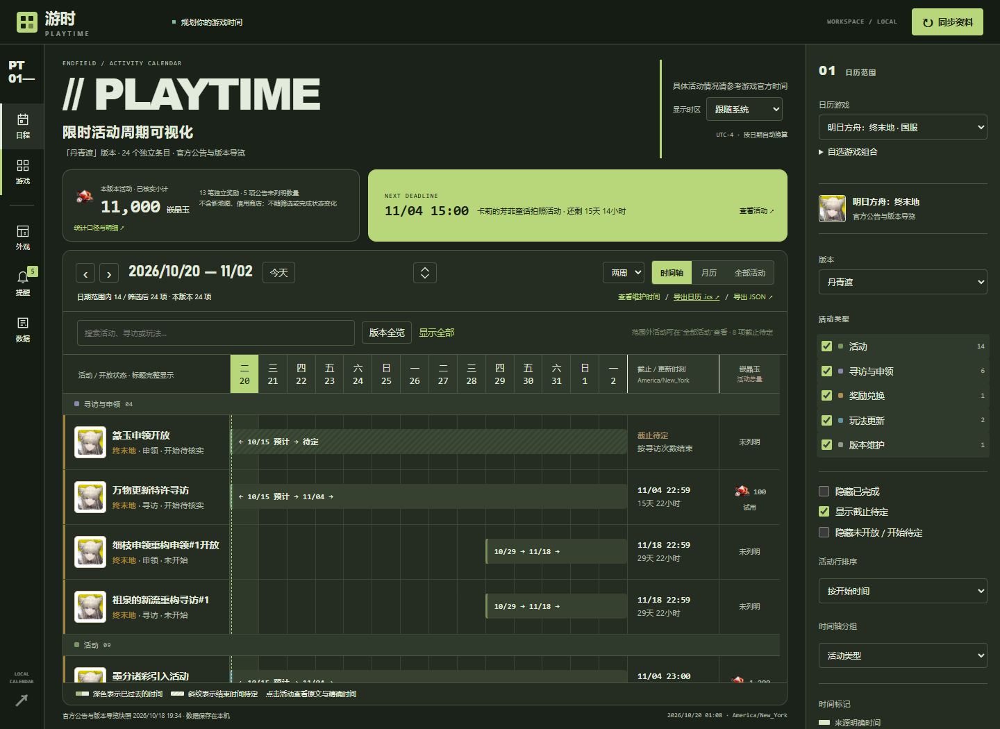
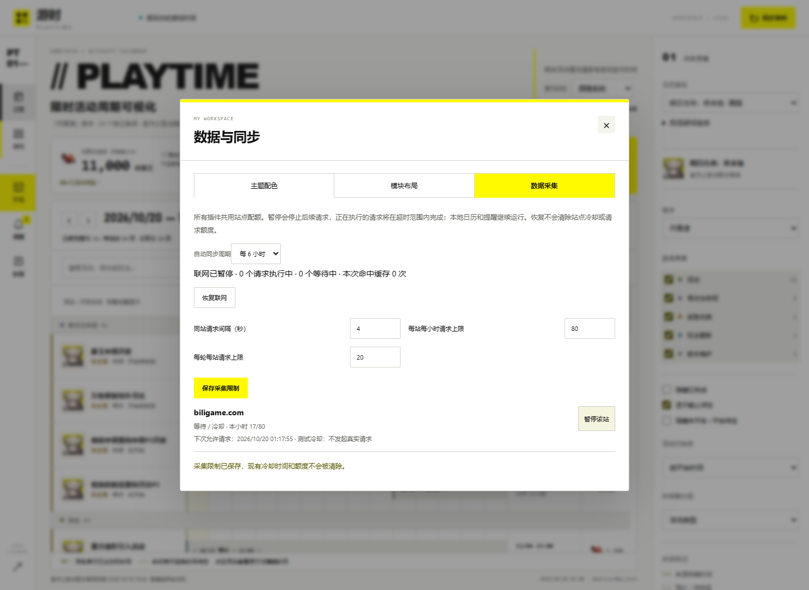

# 布局、主题与采集设置（v0.2.0）

本文适用于 v0.2.0；升级方式与已知边界见 [发布说明](releases/v0.2.0.md)。

提供模块布局、共享主题、保守复查、提醒范围、备份恢复与插件管理。插件 API 仍为 1，旧 manifest 和活动 JSON 不需修改；这些功能需使用 v0.2.0 的源码和桌面构建。

更新后先从托盘选择“退出游时”，再运行根目录 `Playtime.cmd`。只使用网页时停止旧后端，重新运行 `start.ps1` 或 `app.py`，再刷新浏览器。

## 页面布局

网页左侧工具轨道点击 **外观 → 模块布局**。来源说明、活动奖励、近期截止、日历/时间轴、个人计划为独立模块，宽屏时奖励与截止概览并排。拖动设置中的模块行或使用上下箭头排序，选择显隐/折叠后保存；也可点击“直接调整页面”，用模块标题栏拖动、上移/下移或折叠，完成后点击页头“完成布局调整”。直接调整会立即保存。提醒和数据另有工具入口，解析 JSON 位于筛选栏“来源与高级工具”。

日历主模块不能隐藏，折叠后保留展开按钮。空模块在正常模式自动隐藏，进入调整模式后可定位。个人计划可从日历工具栏创建/编辑/移动/删除，并以独立时间条与月历标记展示，操作见 [规划说明](planning.md)。

游戏筛选栏可显示/隐藏、放在左侧或右侧，宽度 180–360 像素。网页铺满视口，不再设置页面最大宽度；旧配置的 `max_width` 仍可读取，但不再限制工作区。隐藏后可从工具轨道“游戏”按钮恢复，工具轨道本身保留。窄屏轨道变为横向，内容自动单列。宽屏主页面固定，日历占用剩余高度；手机整页自然滚动，默认显示近期截止列表。宽屏时间轴内部滚动，固定日期表头与活动名称列。侧栏和设置对话框可独立滚动。不提供任意坐标摆放或逐模块自由缩放。

时间轴工具栏中间的 **展开箭头** 会临时收起页头、导航、筛选和概览，只保留日历操作与日历内容；再次点击或按 **Esc** 还原。若活动详情正在打开，Esc 先关闭详情。展开不会写入布局，也不会清除游戏组合、筛选或排序；数据刷新保留列表阅读位置。最近截止模块整块使用主题强调色与配套文字色。

WPF 桌面采用同一模块顺序、显隐/折叠、侧栏左右位置与宽度，可将月历放在活动卡左侧或上方。网页的“侧栏显示”开关用于网页；桌面的原生侧栏收起按钮、气泡模式继续由桌面原有设置控制。桌面设置中的“编辑模块布局”打开详细网页编辑器；桌面刷新后读取新偏好。

“恢复默认布局”只重置布局，不修改主题、游戏组合、个人标记、提醒或公告日期。

## 主题外观

在 **主题配色** 中直接选择“标准 · 游时”“深色 · 静夜”或五游戏预设。19 种颜色按表面与文字、强调与导航、时间条与活动类型分组；几何与排版另提供字号 12–18、网页面板圆角 0–28、网页控件圆角 0–40、桌面气泡圆角 0–16、桌面按钮圆角 0–12、字重 600–900、间距 8–24、边框 0–2、纹理类型/强度及底色不透明度 35%–100%。预览后应用，网页与桌面共用偏好。自定义状态可直接切回标准，不重置布局。

终末地预设参考官网，采用工业白黄（#FFFA00）和硬边；明日方舟采用用户参考图中的黑青与网格；绝区零采用黑白荧光绿与斜线，网页面板/控件圆角 22/32，桌面气泡/按钮为 8/6。网页和桌面圆角独立设置，左上角软件标识保持固定形状。NIKKE 绯红、碧蓝航线海蓝继续保留。设计与截图见 [设计体系](design-system.md)，这些是本软件的风格预设，不表示游戏官方主题。

正文与各表面、导航字与导航底、强调块字与强调块、时间条字与时间条底至少 4.5:1；次要文字与链接至少 3:1。强调色用于色块，可选择亮黄，其文字单独配置，链接不再强制使用同一颜色。不合格配置显示错误并保留原主题；底色透明度不降低文字和图片透明度。未修改旧工厂主题升级到新版，自定义旧颜色与导入 JSON 会补齐新增角色并保留已有值。

桌面气泡模式的底色不透明度仍在桌面设置独立调整；网页主题和普通桌面卡片使用共享主题透明度，切换主题不会覆盖气泡的透明与鼠标穿透配置。

可导出主题 JSON，再通过“导入主题”恢复。导出的是编辑器当前值；导入上限 10 KB，经同一后端校验后立即保存。不接受 CSS、HTML、脚本或额外主题字段。“恢复默认主题”不重置布局或活动状态。

## 统一采集限制

在工具轨道 **数据 → 数据采集** 中查看执行中/等待中请求、缓存命中、站点用量、暂停状态、下次允许请求时间及最近错误。可暂停全部联网或单个已出现站点。桌面“采集”页另有直接“暂停 / 恢复联网”按钮。

| 项目 | 默认值 / 行为 |
| --- | --- |
| 自动复查 | 默认 24 小时，支持 18 小时；各游戏另随机延后 0–2 小时，保存计划不随重启重抽 |
| 首次 / 离线过期补查 | 随机延后 1–10 分钟，重启不强制抓取 |
| 同站请求开始间隔 | 默认至少 10 秒，可调整为 10–60 秒；另加 0–5 秒随机延迟，来源客户端更严格的间隔继续有效 |
| 并发 | 同站 1 个，全局至多 4 个 |
| 每站小时配额 | 120 次，可调整 20–120；从该站首个请求起计算一小时窗口 |
| 每轮每站配额 | 64 次，可调整 5–64；含公告、图片及跳转 |
| 单个采集任务跨站总量 | 至多 160 次；各游戏任务单独计数，不是五游戏组合总预算 |
| 新鲜缓存 | 文本/JSON 最多 5 分钟，图片最多 24 小时；源站更短的 max-age、no-cache、no-store 优先 |
| 条件请求 | 支持时使用 ETag / Last-Modified，304 复用缓存 |
| 公共 HTTP 缓存容量 | 至多 256 份响应体 / 128 MB；只清理自身哈希缓存，不清理个人数据或已导入素材 |

倒计时与提醒使用已有 UTC 日期在本地计算，断网也能继续运行；24 小时复查用于发现新公告、更正与新版本，不是重新获取倒计时。网页每 10 秒、桌面每 15 秒读取的是本机服务，并非访问游戏网站。没有将版本长度写死为 90 天。成功从完成时间计算间隔，失败后也不密集自动重试。设置可查看每款游戏的下次自动复查时间（本机时间）。

旧的 1/3/6 小时配置一次性迁移为 24 小时；18/24 小时选择和更严格的请求间隔保留。过密的请求间隔上调为 10 秒，过高配额收紧至新上限；暂停、已用额度、冷却与个人数据保持不变。

同一运行实例的全部可信来源引擎、图片、自动与手动同步共用限制器。BWIKI 与 `patchwiki.biligame.com` 共用 `biligame.com` 预算，GameKee、鹰角、PRTS、森空岛、HoYoverse 的子域按各自已配置根域分组；其他 CDN 按主机名计数。纯本地 JSON 插件不联网，独立外部采集程序需自行限流。

手动或强制同步不能绕过限制。遇到网络/HTTP 错误，本次请求返回失败，后续访问冷却 30 秒起、指数增加至 1 小时；不在一次失败后密集重试。`Retry-After` 的秒数或日期可延长冷却。401/403、识别出的验证页或连续三次错误会暂停该站，不绕过验证。恢复不清除冷却和已用配额。

暂停阻止后续请求，已执行请求在其超时范围内结束。新鲜缓存仍可读取，本地日历与提醒继续运行。额度用尽或采集延期时保留已有快照，来源状态可能提示额度/冷却错误；图片未获取不会阻断已有活动时间显示。

策略、用量、冷却与暂停保存在本地，重启不能清空配额。缓存命中和活动请求数是本次进程状态。限制器在**单一运行实例**内统一调度，同一数据库的自动复查通过 SQLite 事务避免重复领取，但多个进程的 HTTP 配额仍分别统计；不协调不同数据库或设备，不保证源站永远允许访问；仍须遵守源站规则，出现拒绝或验证时停止访问并保留缓存。

## 个人数据备份与恢复

位于“数据与同步”面板底部。备份是数据目录 `backups/` 下的 JSON 文件，可下载或复制到别处保存。

- **包含**：收藏、完成/忽略状态、备注、活动日期校正与维护实际开服时间、单活动提醒设置、个人计划、显示设置（时区、视图、提醒提前量等）、工作区布局与主题、采集限制与全局暂停。
- **不包含**：官方活动快照、图片与 HTTP 缓存（同步可重新获取）、提醒历史（保留现有去重，恢复后不会重复弹出已发过的提醒）、各站点的冷却与已用额度（恢复旧备份不能绕过限流）。桌面窗口位置一并写入备份文件，但暂不自动恢复。
- **与导出的区别**：活动 JSON / ICS 导出只用于查看或导入其他日历，不能用于恢复，选择这类文件会被拒绝。
- **自动备份**：程序版本变化后首次启动、在任何迁移之前自动备份一次（数据为空时跳过）；每次恢复前先备份当前数据。自动备份保留最近 20 份，手动备份不会被自动删除。
- **恢复**：从列表或“从文件恢复…”选择备份并确认。恢复前按正常保存的规则检查格式、版本、全部数据分区与每个字段；来自更新版本或缺少分区的备份会被拒绝，此时当前数据不变。恢复在一个数据库事务中替换个人数据，完成后再读取校验，失败则回到恢复前的状态；恢复进行时其他窗口的保存会等待，不会丢失。未安装插件的计划与选择会保留并给出提示。

## 验证

日期聚焦、活动折叠、截止密度与个人计划的使用方式见 [规划说明](planning.md)。折叠状态与日期/游戏选择独立于主题和布局保存，恢复布局或主题不会删除计划。

v0.2.0 发布检查通过 277 项后端测试、17 组浏览器回归和 WPF 隔离自检，未对真实信息站进行压力测试。覆盖备份恢复、插件启停、提醒范围、个人规划、日期校正与夏令时、手机布局，以及原有主题、模块布局、限流与窗口行为。

保守复查调度修订曾通过 206 项后端测试、采集偏好与日历提醒两组浏览器回归及 WPF 离线自检；使用模拟时钟覆盖首次错峰、24 小时间隔、重启保留、同库重复领取与旧设置迁移，没有向源站发起压力请求。

本轮 F08–F11 另覆盖明确关系与折叠、共享焦点/时区、截止去重、夏令时 23/25 小时日期和重复/不存在时刻、计划创建/修改/移动/删除与来源独立性；WPF 自检增加 `plannerVerified`。个人计划编辑器位于本地网页，原生桌面显示计划卡与时间进度。详见 [规划说明](planning.md)。
