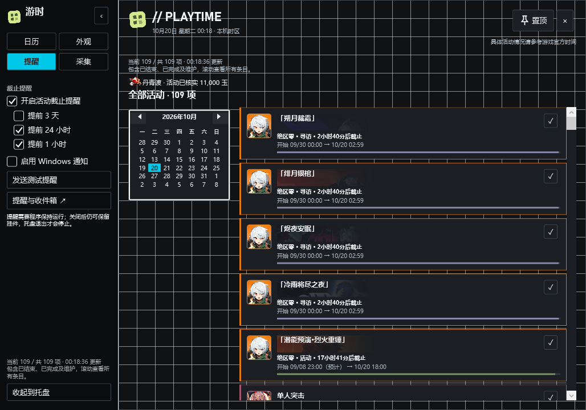
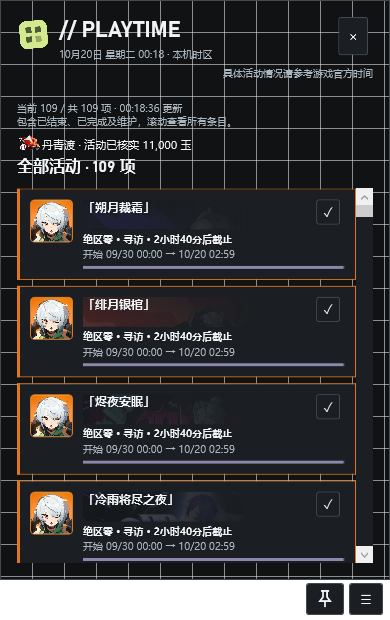

# UI / UX 层级调整（v0.1.0）

目标：让高频操作常驻可见，低频设置按职责分组；保留插件 API 1 和既有数据。

视觉骨架与三种风格已按官网参考重做，详见 [设计体系与实图](design-system.md)。本页记录功能入口层级。

| 层级 | 网页 | Windows 桌面 |
| --- | --- | --- |
| 每次使用 | 游戏/组合、筛选、日期与视图 | 日历页：游戏/组合、活动范围、视图 |
| 全局快捷入口 | 独立工具轨道：日程、游戏筛选、外观、提醒、数据；同步按钮单独保留 | 主窗口顶部置顶；挂件右下角：图钉、侧栏 |
| 外观 | 主题预设、细节、自定义布局 | 外观页：主题、布局、气泡/尺寸、关闭行为/靠边隐藏 |
| 提醒 | 独立提醒与收件箱 | 独立提醒页：截止提醒、提前量、系统通知 |
| 数据 | 独立数据入口：限流、缓存、冷却；高级规则按需展开 | 独立采集页：联网开关、状态和站点策略 |

标准工业白底、深色及五游戏皮肤并列。终末地采用白黑黄与硬边，明日方舟采用黑青网格，绝区零网页采用荧光绿与大圆角，桌面使用更紧凑的独立圆角；19 个语义颜色与几何独立配置。选择预设可直接回到标准，无需恢复其他设置，不表示官方授权主题。

网页铺满视口，主页面固定，只有日历内容与侧栏独立滚动。最近截止使用整块主题强调色。日历工具栏中央展开箭头可收起所有周边界面，再次点击或 Esc 恢复；此状态不覆盖模块布局或游戏筛选。软件标识不使用可变控件圆角。

桌面关闭按钮/任务栏关闭使用同一策略：默认保留为桌面挂件并移除任务栏按钮，也可选择收起托盘。托盘“退出游时”才结束程序。用户可启用靠边隐藏：仅挂件模式生效，贴到当前显示器工作区左右边缘后，离开一小段时间收成可见边缘标签；悬停展开，移开后再次收起。打开侧栏或操作控件时不收起；提醒与同步不受影响。任务栏图标隐藏不等同于退出，也不修改 Windows 系统任务栏设置。

无障碍：图标按钮有文字提示与可访问名称，键盘可操作；深色复选框使用主题文字颜色绘制勾号；挂件工具条占独立区域，不遮挡活动卡、不覆盖透明间隙。

验证：主题/偏好旧格式兼容、预设切换、分组入口、窄屏，及原生置顶、关闭后常驻、边缘收起/悬停、复选框对比度、透明气泡穿透与偏好恢复。

当前源码已实现以上分层，194 项后端测试、七组浏览器回归和 WPF 隔离自检通过。桌面自检通过真实关闭事件确认窗口仍可作为挂件显示；边缘测试驱动实际窗口收起/展开状态，验证尺寸和保存偏好，不操作其他应用。

