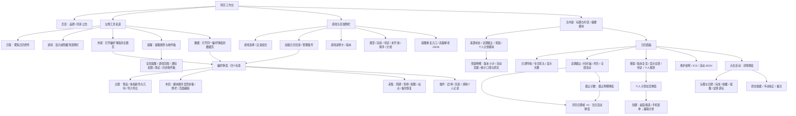
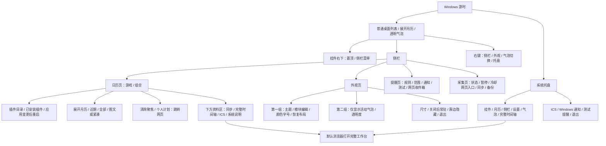
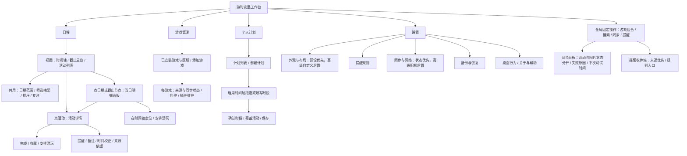
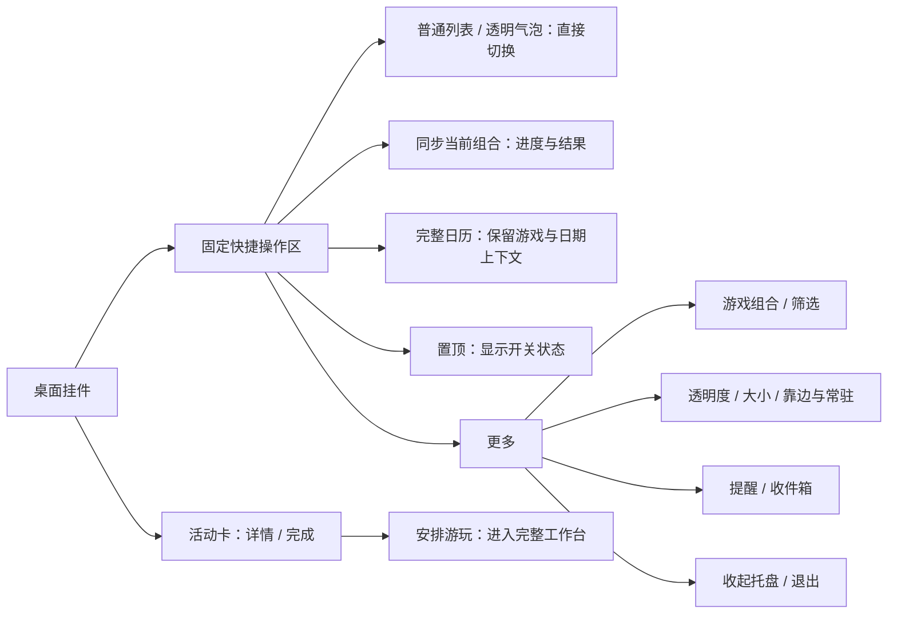

# 游时 UI/UX 层级与任务流程审查

日期：2026-10-27　作者：Codex　状态：设计提案，尚未实施

本轮盘点当前工作区中的网页、Windows 桌面列表/月历/透明气泡、托盘、窄屏布局及主要弹窗，评估功能可读性、可发现性、操作可达性、页面必要性和排版。没有修改产品布局、用户配置、插件协议或已确认 TODO；本报告中的新结构是待确认方案。

## 1. 结论

当前最影响体验的不是配色，而是信息架构：功能按实现位置累加，高频动作、低频设置和开发工具混放；同一动作有多个入口，但缺少一个稳定、容易发现的主入口。展示模式、日期范围、筛选、聚焦也存在相互改变的情况，用户很难预测点击后的结果。

建议围绕三个问题安排界面：

1. **现在有哪些活动、什么时候结束？** 时间轴、截止总览、活动列表。
2. **我准备什么时候玩？** 独立的个人计划，必要时叠在时间轴上。
3. **我能否相信这些资料已更新？** 常驻且简明的同步状态，按需展开诊断。

桌面端承担快速查看、标记与窗口模式切换；完整工作台承担跨游戏比较和计划编辑。两端共用同一活动身份、游戏组合与明确的跳转上下文，无需先改插件架构。

## 2. 审查范围与证据

- 源码：`web/index.html`、`app.js`、`customize.js`、`planner.js`、`plan-drawing.js`、`workspace.js`，以及 `desktop/Program.cs` 和全部 `CalendarWindow.*.cs` 的界面构建、状态切换与跳转。
- 网页现场：独立临时服务器，五游戏源码快照，1440×900 与 375×812，固定客户端时间 2026-10-27 16:00（America/New_York）。`--no-sync --no-desktop`，未联网抓取，未读写真实 `data/`。
- 现场记录与截图：`logs/uiux-audit-20261027/observations.json`、同目录 PNG；可重复采集脚本 `inspect.cjs`。检查了默认/全览/专注时间轴、本月与切换后的月历、外观、数据、插件、个人计划、提醒、详情及手机筛选。
- 桌面视觉参考：既有隔离自检 `logs/desktop-smoke/20261027-200000-596/` 的 `sidebar.png`、`bubble-settings.png` 等，并与当前源码交叉检查。**本轮没有重新驱动原生窗口或完成屏幕阅读器/真实触屏测试。**
- 说明：离线测试中的“自动复查由启动参数关闭”、原生通知不可用、尚无请求记录是测试条件，不作为产品缺陷。截图中无头图不用于判断采集能力。这里是代码与界面的专家审查，不是用户研究或可量化的效率实验。

### 可复核的界面事实

| 观察 | 含义 | 证据 |
|---|---|---|
| 1440×900 普通布局的 `#calendar` 活动内容区约 372px，专注后约 718px | 同一窗口能容纳的活动几乎翻倍；普通布局的主任务面积不足 | `web-1440-timeline.png`、`web-1440-expanded.png`、JSON 中对应矩形 |
| 五游戏本月产生 35 个 `+N 项` 入口；部分日期为 +24 至 +35 项 | 月历仅显示前三条并行轨道，长活动容易占满轨道，查找其他活动成本高 | `web-1440-month.png`；`monthWeek()` 的 `lane < 3` |
| 月历内容高度约 797px，容器约 372px | 连完整月网格也需内部滚动，削弱整月总览用途 | `web-1440-month` 记录 |
| 375px 宽时活动内容起点约 y=391；展开筛选后约 y=679 | 首屏大量被导航、范围和状态占据，展开筛选时几乎看不到活动 | `mobile-375.png`、`mobile-filters.png` |
| 数据设置把网络参数、每游戏排程和备份放在同一纵向内容里 | 找“恢复备份”需要先穿过与其无关的网络设置 | `web-data.png`、`index.html` 网络面板 |
| 桌面外观先构建共享主题/布局，再构建气泡开关 | 气泡是第二组内容；小高度或保留滚动位置时需滚动才能找到 | `BuildDesktopSettings()`、`BuildWorkspaceSettings()`、`bubble-settings.png` |
| 原生侧栏四个页面共用一个 ScrollViewer，切页没有明确复位代码 | 原页面滚动位置可能增加跨页寻找成本，值得原生复测 | `BuildSidebar()`、`OpenSidebarPage()` |

## 3. 当前层级流程图

图中“→”是入口/跳转，不表示每个节点都是独立页面。同一个偏好弹窗会从不同入口打开不同标签。

### 3.1 网页工作台：现状

现状中的非预期关系：

- “游戏”并不进入游戏管理；“日程”也不等于切回时间轴。“外观”和“数据”看似两个页面，实为同一弹窗中能互相切换的四个标签。
- 插件的入口在侧栏，但插件管理也出现在“外观”弹窗；备份在“数据采集”之下，技术上同属数据，用户任务上却不相近。
- 同是点日期：日期格打开当天开放活动与计划，截止计数打开另一种截止明细；后者还能再进入前者。这两种列表的数量、包含范围不同，却并列在很小的日期格中。
- 点击“显示全部”会清空搜索、类型、部分状态、日期聚焦，并切到列表；“版本全览”也会调用这个重置过程，再改变日期跨度。名称没有揭示这些副作用。

### 3.3 二级及更深操作清单

| 容器 | 更深内容 / 行为 | 判断 |
|---|---|---|
| 活动详情 | 头图、起止/倒计时、阶段、参与条件、奖励；完成、收藏、安排游玩、单活动提醒；原文依据；时间校正、备注；维护活动的实际开服确认 | 保留一个主详情，但核心信息和动作应固定在前，高级校正后置 |
| 当日活动 | 当天开放活动、计划、进入活动详情与创建计划 | 与截止明细采用同一面板的不同筛选，清楚显示当前统计范围 |
| 截止明细 | 活动/阶段关闭、兑换关闭及精确时刻；再打开当日活动 | 不再为了看同一天的另一种内容切换第二个模态框 |
| 版本奖励 | 已核实小计、活动/补偿口径、贡献条目与来源 | 保留适用游戏下的独立按需详情 |
| 个人计划总览 | 新建、已有计划；期间可参与活动的折叠列表；编辑/移动 | 升为一级任务页；覆盖活动列表保留逐层展开以控制长度 |
| 计划编辑 | 名称、时间、时区、夏令时重复时刻、游戏/活动关联、备注；保存、移动、删除 | 基础字段优先；特殊时刻选择在必要时提示，不让每次创建都像填写高级表单 |
| 提醒与收件箱 | 全局开关/提前量/范围、系统与浏览器通知、测试、历史与已读 | 消息优先，规则单独进入；保留单活动覆盖规则 |
| 主题 | 预设/预览；表面文字、强调导航、活动类型、几何排版；应用/恢复/主题文件导入导出 | 默认预设与预览；大量令牌属于高级展开项 |
| 布局 | 模块排序/显隐/折叠、侧栏位置尺寸、桌面月历位置、直接编辑、默认恢复 | 保留编辑模式，明确退出；普通使用不显示所有编辑柄 |
| 数据采集 | 周期、各游戏排程、全局暂停、站点状态与暂停、请求限制、保存限制 | 先展示是否更新成功与可执行动作，技术参数进入高级区 |
| 备份恢复 | 建立/下载备份、备份列表、文件恢复、差异预览、确认/取消 | 独立分类；确认步骤有必要，不能为减少点击而删除 |
| 插件 | 目录、内置/插件、版本与错误、启停、待重启状态；清除个人记录的预览/确认 | 游戏管理中集中；危险动作后置并保留安全备份 |
| 解析 JSON | 配置 / 版本解析结果 / 下载 | 开发与诊断工具，不承担日常导航 |
| 原生补充入口 | 右键、托盘、双击标题切换挂件/月历、拖动空白处移动、边缘标签唤出 | 保留熟练用户捷径，但不能作为高频功能唯一发现方式 |

### 3.2 Windows 桌面端：现状

需要澄清：当前普通窗口有顶部图钉，紧凑/气泡有右下图钉与菜单；气泡也有右键、托盘快捷入口，**不是完全没有快捷方式**。问题是这些入口并不形成可见、稳定的日常操作区。侧栏收起时，窄工具轨道中的“同”同步按钮也会随之消失。

## 4. 功能与页面必要性

### 补充：时间轴日期表头的点击职责

**[Codex 2026-10-27，依据用户追加反馈]** 用户指出时间轴日期点击后的聚焦缺乏实际用途，而且妨碍理解日期。当前 `densityButton()` 把日期数字与截止数量做成同一个整格按钮，即使零截止也能点击；`deadlines()` 先通过 `focusDay()` 写入共享日期/时区，再打开截止明细。这会先改变整张时间轴和其他客户端的查看范围，再给出一份可能为空的截止列表。日期表头同时承担坐标、按钮、截止统计和全局筛选，行为明显超出“点一下日期看看”的预期。

建议明确拆分：

| 元素 / 状态 | 行为 |
|---|---|
| 日期与星期 | 默认是稳定时间尺，不再整格作为全局筛选按钮；不能因查看详情而隐藏其他活动 |
| 有截止时的“截止 N”标记 | 独立可访问按钮；打开对应日期的本地明细面板，不改全局聚焦、不改变日期范围 |
| 没有截止 | 不显示空按钮或无意义的点占位；日期照常可读 |
| 当日明细 | 必须有明确日期和精确时刻；可切换截止节点/当日开放活动，查看结束时恢复原滚动与缩放 |
| “只看这一天” | 明细中的显式可选操作，才改变全局日期筛选，并显示可关闭标签 |
| 创建个人计划模式 | 用户明确启用后，日期轴/轨道才承担拖选；取消后恢复查看模式 |
| 今天 | 使用独立竖线与“今天”标签；不与“正在查看某天”的样式相同 |
| 正在查看某天 | 仅在明细面板打开时显示局部细边框/提示；关闭后解除，不长期改变时间轴 |

短范围可显示月/日与星期；长范围按月份与周级主刻度组织，日级作为次刻度，放大后恢复每日标签。不能为了版本全览，把每个可点击日期挤到约十像素宽，或用缺少月份语境的裸数字制造跨月歧义。鼠标经过某天可做浅色列辅助对齐，但不能依赖悬停才能获取日期，触屏和键盘仍需有等价的明确入口。

验收新增：普通查看时点击日期不写共享 `focus`、不减少时间轴行数、不改变另一个客户端；截止标记一次操作可看到有用明细；零截止不弹空截止窗；全局日期筛选仅在显式操作后出现，且能单独清除。这是设计方案，尚未改动产品代码。

### 页面与模块职责

| 现有内容 | 用户主要目的 | 建议位置与必要性 |
|---|---|---|
| 时间轴 | 比较多游戏周期、重叠与剩余时间 | 日程默认核心视图；保留 |
| 月历 | 识别忙于哪些截止日、挑选某天 | 改为“截止总览”，保留月份空间索引；不要默认铺满活动持续条 |
| 近期截止 | 今天/明天先做什么 | 截止总览的列表形态；手机/挂件可作为默认，仍复用同一节点数据 |
| 全部活动 | 搜索和检查完整目录 | 名称改“活动列表”；独立于是否清除筛选 |
| 最近截止色块 | 第一眼看到迫近节点 | 保留为简短摘要/进入截止总览的入口，不再抢占一整层高度 |
| 个人计划 | 安排游玩并比较覆盖活动 | 升为一级“个人计划”；保留活动详情与时间轴拖选快捷入口 |
| 游戏选择、组合 | 切换当前观察范围 | 日程顶部的范围控件；不与安装插件混排 |
| 插件与游戏管理 | 添加、启停、移除游戏 | 一级“游戏管理”，集中区服、来源、更新与插件状态 |
| 提醒收件箱 | 查看错过了什么 | 常驻铃铛进入；规则设置折叠或链接到设置，不挡在消息前面 |
| 主题与布局 | 个性化，不改变活动 | 合并在设置“外观与布局”，默认只呈现预设、密度、主要布局选项 |
| 网络限制、解析 JSON | 诊断或维护 | 设置“同步与网络 → 高级”；非日常主界面内容 |
| 备份恢复 | 保护和迁移个人记录 | 设置的独立分类，不嵌在配额页面末尾 |
| 版本奖励 | 了解可获取资源 | 只在适用游戏出现，摘要可收起；跨游戏明确币种与范围 |
| 系统日历说明、许可 | 理解能力边界与出处 | 帮助/关于；保留 ICS 操作旁的简短解释 |

上述页面是任务分类，不要求复制同一模块、开多个独立服务或改插件协议。截止总览内部可以提供“月份 / 近期列表”切换，避免再增加一级页面。

## 5. 月历应如何调整

同意把它主要用于**截止密度总览**，但不称“游玩负担”：活动数量不能代表需要投入的分钟数。

- 日期格优先显示：活动/阶段关闭数量、兑换关闭数量；只统计当前游戏组合内明确、未完成的节点，复用已有去重规则。
- 常驻/长活动不在每个开放日期重复画长条；不再让按开始时间先排入的长活动长期占满前三轨，代表不了当天需要关注的几十项活动。
- 预计、截止未知单独显示为“待确认”，不能混进精确截止数。日期按所选显示时区计算，跨日与夏令时规则不变。
- 开始节点可以做独立开关或次级小标记；同一天同时开始和结束时，必须区分语义。
- 个人计划使用独立样式标记；如果显示分钟合计，只能合计用户实际安排的计划，并说明重叠计划的计算口径。
- 颜色只表示截止数量层级，始终带数字与文字图例。收藏是重点标记，不改变截止数量。
- 点日期后：桌面右侧显示当日明细，手机显示底部面板，按当地的具体时刻排序；直接列标题、游戏、节点类型、时间和操作。
- 明细内可“完成 / 查看详情 / 在时间轴定位 / 安排游玩”。截止明细与当日开放活动通过同一面板的筛选切换，避免两个相似弹窗来回跳。
- 点日期只先选择这个面板；是否将整个工作区限定到这一天应有明确操作，避免网页一次临时查看影响另一端的挂件内容。
- 默认展示整月；小窗口优先收起摘要，避免月网格本身再滚动。手机可以更紧凑，但不牺牲日期和计数的可读性。

已有 `presentation.deadline_nodes`、截止密度、待定列表、个人计划和关联数据可复用；主要是呈现与交互职责调整。

## 6. 建议的新层级流程图

### 6.1 完整工作台

各页保留当前游戏组合、时区和明确的日期上下文；“游戏管理”不会顺手改变当前查看组合。快速入口和设置入口可以指向同一个功能，但只能有一套命名和状态。

### 6.2 桌面挂件

普通窗口可用顶栏，透明气泡用原右下浮动操作区；三个高频动作“气泡切换、同步、完整日历”均应可见且无需滚动。继续保留图钉。右键和托盘作为补充，不承担唯一的常用入口；用户选择自动淡出工具时，仍保留一个明确可唤出的把手。

当前“完整时间轴”实际会打开系统默认浏览器，而且只携带游戏参数，并不保证打开时的偏好视图就是时间轴。第一步应明确“打开完整日历 ↗”或真正传递时间轴视图和日期上下文。是否内嵌 WebView 是后续产品选择，**不应成为本轮整理入口的前置条件**。

## 7. 主要问题、改法与优先级

| 编号 / 优先级 | 现状与影响 | 调整建议 | 验收 |
|---|---|---|---|
| U01 / P0 | 挂件气泡、同步、工作台藏在侧栏/右键/托盘，展开侧栏还会挤动窗口 | 固定快捷操作区；气泡、同步、完整日历直达 | 320px 宽、320/620px 高均不滚动找到；每项从主界面一次操作可触达 |
| U02 / P0 | “游戏”“外观”“数据”标签与实际内容不一致 | 日程/计划/游戏管理/设置；给原操作正确的按钮动词 | 初次使用者不必猜“哪个设置里面还有另一个设置” |
| U03 / P0 | 普通主内容区域不足；安装说明长期占据日常侧栏 | 压缩品牌标题；游戏管理说明后移；顶部保留一行范围与操作；摘要按需收起 | 同样 1440×900，日常活动内容高度目标 ≥540px；以实际渲染复核 |
| U04 / P0 | 月历大多数信息进入 +N，多游戏长条拥挤 | 截止密度月历 + 当日明细；时间轴处理周期 | 标准屏幕一眼看到整月；目标日期一次点击看到每条具体时刻 |
| U05 / P0 | 日期范围、聚焦、类型、搜索共同隐藏活动；“显示全部/全览”还隐含重置 | 常驻可关闭的筛选标签；“清除筛选”独立；日期缩放不偷偷改筛选 | 任何空态都能说清范围、原因，并一键解除对应条件 |
| U06 / P0 | 来源名称容易被误读为已经同步成功；原始错误又可能挤满页面 | 一行状态：资料日期 / 活动更新 / 图片待补；错误分人话摘要和可展开详情 | 同步部分成功时明确可用内容；不把使用缓存写成已更新 |
| U07 / P1 | 提醒规则挡在收件箱历史前；备份在网络参数下方 | 收件箱与规则分区；备份独立设置分类 | 找最近未读不用先滚过规则；恢复备份不穿过网络配额 |
| U08 / P1 | 个人计划在工具行中像辅助按钮；模块、总览和编辑弹窗入口分散 | 一级计划页面、时间轴内保留拖选入口，活动详情可直达 | 在拖选前明确进入创建状态，可取消，保存后回到原日期/滚动位置 |
| U09 / P1 | 单条详情同时放大量说明、奖励、规则和表单 | 顶部固定头图/标题/明确起止/状态；完成、收藏、安排常驻；原文与校正后置 | 在低高度屏幕不滚动也能读完核心时间并找到主要动作 |
| U10 / P1 | 原生主题、布局、透明度、关闭行为混排且共享滚动 | 快速窗口模式独立；高级外观用分组导航；切页复位或按页记忆 | 切换设置页后不会从上一页的深滚动位置开始找功能 |
| U11 / P1 | 手机版多层横栏/说明挤占首屏，展开筛选推走内容 | 过滤器改底部面板；首屏保留组合、更新、视图与近期活动；高级工具合并 | 375×812 首屏至少能识别三个近期节点；筛选不推走整页 |
| U12 / P1 | 全览之后切月历会沿用全览的最早日期，样本从 10 月跳到 8 月 | 跨视图锚点优先当前选中日期，其次今天；显示改变后的日期上下文 | 全览切本月不会意外跳历史月份；允许明确保留所选历史月份 |
| U13 / P2 | 多种同形按钮混用操作/导航/开关，单字“同/历”和无文字专注箭头难认 | 高频功能有文字；开关有当前状态；外跳明确标注；高级解释用帮助 | 不悬停也能区分“当前模式”与“按下后动作” |
| U14 / P2 | 字号/弱色/图片叠字使日期、区服和状态不易扫读 | 语义字号分层；日期固定高对比列；图片主要负责辨识，不承载唯一信息 | 亮/暗/半透明及不同壁纸下都可读；不可只靠颜色区分状态 |
| U15 / P2 | 关闭、最小化、托盘退出、常驻挂件含义不同 | 一处明确设置关闭行为；首次模式转换给简短反馈 | 用户能判断窗口是否隐藏、程序是否仍运行、提醒是否仍有效 |
| U16 / P1 | 原生模式/透明度立即保存，网页主题/布局需要应用，反馈方式不统一 | 保留合理的保存模型，但每组明确“已自动保存”或“未应用”；高级编辑保留应用/取消 | 用户离开设置时知道哪些变化已经生效，不因切页误以为已保存 |

## 8. 高频任务的路径对照

次数按从当前主界面开始的显式点击估计，滚动、搜索入口与跨窗口等待另算；右键/托盘熟练用户可能更快，不把最短隐藏路径当作默认体验。

| 任务 | 当前常规路径 | 建议路径 |
|---|---|---|
| 切换透明气泡 | 侧栏 → 外观 → 找第二组开关（可能滚动） | 固定“气泡”按钮：1 次 |
| 挂件同步 | 侧栏 → 日历下方/采集页 → 同步；侧栏隐藏时窄轨道不可用 | 固定同步：1 次；点击状态查看细节 |
| 打开完整日历 | 侧栏 → 向下找完整时间轴，或托盘菜单 | 固定工作台按钮：1 次，携带组合/日期/视图 |
| 展开网页时间轴 | 无文字双箭头：点击不多，但发现成本高 | “专注时间轴”：1 次；同位置退出，支持 Esc |
| 查看某天即将关闭内容 | 找月历 → 辨认三条与 +N → 区分当日活动/截止弹窗 | 截止总览 → 点日期，明细直接按时间列出 |
| 创建计划 | 工具行个人规划 → 创建 → 转到时间轴拖选 → 表单 | 一级个人计划或时间轴创建 → 拖选 → 确认；保留明确的两阶段，避免误拖 |
| 恢复备份 | 数据 → 数据采集 → 滚过排程和配额 → 恢复 | 设置 → 备份恢复 → 预览 → 确认；保留必要的保护步骤 |

## 9. 排版与交互规则

- 主工作台的视觉优先级：活动内容 > 日期与游戏范围 > 迫近截止 > 同步提示 > 品牌装饰/来源说明。主题可以鲜明，不能用占据大面积的标题代替可用空间。
- 顶部固定区只放稳定、高频、当前范围明确的动作。同步按钮显示同步范围；进行中保留可见进度与已可用的数据，避免无反馈地禁用整个页面。
- 一次主要纵向滚动：宽屏以活动区滚动为主，侧栏仅保留短筛选；复杂设置采用分组与独立滚动容器。手机继续整页滚动，筛选放可关闭的面板；不恢复多层嵌套竖向滚动。
- 查看模式、视口专注、窗口模式和数据筛选分别命名；切换视图不顺带清空用户选择，重置动作清楚说明范围。
- 活动标题、游戏/区服、绝对截止时刻、倒计时有固定位置。倒计时始终配绝对时刻，避免读了剩余时长仍需心算日期。
- 不把所有状态都做成鲜亮警告。已完成/已结束、预计/未知、读取失败/冷却、图片待补应有不同语义；原始异常放“诊断详情”。
- 颜色/圆角属于外观预设；先展示预设和简短预览，详细令牌、纹理和导入导出后置。保留网页与桌面独立几何，不改变软件标识形状。
- 层级深不一定都要扁平化：备份恢复、清除个人记录需要预览确认；普通切换、查询、同步不应借用同样重的操作结构。
- 键盘、触屏、窄窗、高 DPI、长标题和多语言需单独验收。当前已存在部分 aria、Esc 和焦点处理，不据此宣称已完成无障碍适配；图标按钮仍需明确可访问名称和可见聚焦态。

## 10. 推荐实施顺序与边界

1. **入口与命名**：桌面快捷操作区；工作台/专注/日期全览/清除筛选分别命名；同步状态分活动与图片。改动较集中，先减少每天的寻找成本。
2. **空间与导航**：压缩顶部，迁移游戏安装说明；分开游戏管理、备份、提醒收件箱与设置；手机筛选面板。保留现有主题令牌与用户布局，提供明确迁移/恢复方式。
3. **截止总览月历**：复用已有节点/密度与计划数据，增加当日面板；保留时间轴和完整列表，不用统计数字替代查看活动本身。
4. **计划与详情流畅度**：一级计划入口、拖选模式反馈、返回位置、活动关联；减少无意义弹窗切换。
5. **外观与可访问性收尾**：精简默认高级项，测试明暗/透明/壁纸、键盘、低高度与多 DPI。

Provider API 1、活动 JSON、稳定 ID、个人状态、提醒范围、现有去重/时区规则无需随导航重排而改变。需要注意的是视图命名/日期锚点/暂时选中日期与全局聚焦的语义；实施时应更新相应网页、桌面偏好迁移和回归，不重新实现两套业务规则。

不要把这次审查直接改写成已完成 TODO。优先确认新职责与入口，再形成界面草图和具体实施清单，避免只把旧按钮重新排一遍。
