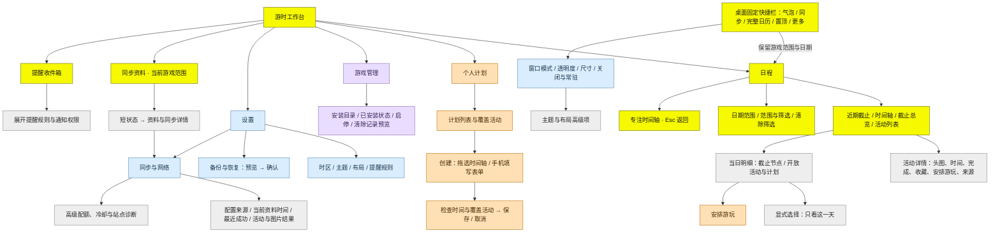

# UI/UX 改造实施记录

**[Codex 2026-10-27]** 本轮按已确认的 [审查与设计](uiux-audit-2026-10-27.md) 实施。Codex 负责网页、共享文档和集成验收；Claude 负责桌面端，详见其 [交付说明](uiux-desktop-handoff-2026-10-27.md)。这是未发布源码，不改变插件 API 1、活动身份、个人数据格式或联网限制。

## 实际入口与流程

黄色是常用入口，橙色是个人计划，紫色是游戏管理，蓝色是设置，灰色是按需展开的明细。网页的计划、游戏管理和设置使用独立弹层，不要求离开当前日程。

## 本轮行为

- 网页默认压缩说明标题，把安装说明移至游戏管理。1440×900、默认布局、五游戏快照下，活动区由审查时约 372px 增至 541px。保留用户主题、模块顺序、显隐、折叠与左右侧栏设置；说明标题可在设置的布局页展开。
- 时间轴日期作为只读时间尺；非零截止有独立按钮。月历以截止与兑换数量、计划标记表示密度，不再只展示前三轨。查看某天只打开本地明细，只有“只看这一天”才经过原有队列保存共享日期聚焦。
- 日期全览只调整日期窗口；清除筛选保持当前视图和日期窗口，不再覆盖操作过程中刚切换的视图。全览后进入月历优先共享聚焦日期或明确导航日期，否则使用今天所在月。
- 同步仍由原有 API 和限制器执行。网页短状态不铺满技术报错；详情按游戏分开说明配置来源、已有资料时间、最近成功、活动变化和图片结果，错误和采集提示在此查阅。来源状态更新由单一模块负责，内容未变时保留按钮 DOM。
- 提醒按钮先进入收件箱；规则可按需展开，也可从设置直接打开。备份与恢复有独立设置页，保留恢复预览、确认和安全备份。
- 个人计划拥有一级入口，继续使用原有计划列表、覆盖活动、选择创建后拖选、表单检查与取消流程。活动详情的时间、倒计时和主要操作靠前，长说明、提醒、来源依据及校正备注分组。
- 手机筛选采用底部浮层，保留底层日程位置；面板打开时背景不可交互，Tab 在面板内循环，Esc 关闭并返回入口，扩大到桌面尺寸时清理浮层状态。375×812 首屏至少可识别三个近期截止节点；手机也可在设置调整时区。
- 桌面由 Claude 增加五个固定快捷操作，窗口设置优先于高级主题，按页记忆滚动位置，并说明关闭、保留挂件、托盘与退出的区别。即时保存和需在网页点击应用的编辑分别说明。

## 验证与边界

所有后端、浏览器和桌面测试使用隔离目录，不读写真实 `data/`，不联网采集。审查基线位于 `logs/uiux-audit-20261027/`，本轮浏览器结果和截图位于 `logs/uiux-implementation/`。

- 后端：315 项 unittest 通过。
- 浏览器：21 组 e2e 完成验证；个人计划月历用例在并行回归暴露异步全览覆盖后续月份的问题，修复并用延迟响应回归与原用例复核。
- 新验收：`tests/e2e-uiux.cjs` 覆盖日期查看不改共享焦点、显式日期聚焦、全览保留筛选、月历适配、独立入口、手机首屏与浮层、错误转义和桌面日期链接首屏生效；原有日期队列与状态轮询竞态测试继续保留。另用延迟返回的设置响应验证日期全览不能覆盖随后选择的月份。
- 桌面独立复核：Release 构建 0 警告、0 错误；`logs/desktop-smoke/20261028-005401-850/result.json` 为 `ok:true`，109 条活动，包含 `quickActionsVerified:true`，以及原有外观、交互、计划、备份与功能一致性检查。
- 真实触屏、不同 DPI 和讲述人的完整验收尚未进行，不以自动化测试代替这些结论。320×320 普通挂件活动区仍偏小，已另列后续优化，不影响底部快捷按钮。

使用源码新界面需退出旧程序并重新启动，再刷新网页；本轮没有修改版本号或发布 Release。
