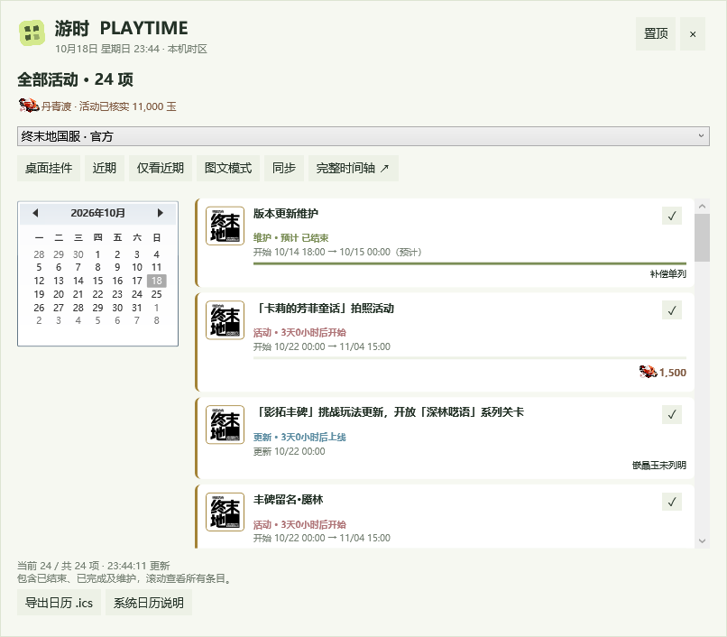

# Windows 桌面版

## 使用

双击项目根目录的 `Playtime.cmd`，或在 PowerShell 运行：

```powershell
./start-desktop.ps1
# 不联网，使用本地缓存与快照：
./start-desktop.ps1 -Offline
```

本机编译产物位于 `dist/desktop/Playtime.exe`。桌面程序是 .NET WPF 原生窗口，通过本机临时端口启动独立 Python 服务；无需开启浏览器即可查看挂件、月历、倒计时或标记完成。“完整时间轴”会打开原有网页界面。

可执行 `powershell -NoProfile -ExecutionPolicy Bypass -File scripts/install-desktop-shortcut.ps1` 在当前用户桌面创建 `Playtime` 快捷方式；不会覆盖指向其他程序的同名快捷方式。这里的执行策略参数仅应用于本次 PowerShell 进程。

- 拖动“游时 PLAYTIME”标题移动挂件，位置与置顶设置保存在 `data/desktop-window.json`。
- 点击“置顶”可让窗口保持在其他窗口前面；默认不置顶。
- 点击“展开月历”进入月历，选择日期查看当天活动；“近期”返回近期活动。
- 默认以紧凑行显示更多条目，“图文模式”可切换大卡片；活动头图来自本机缓存，左侧淡出。
- “全部活动”展示所有版本条目，包括维护、已结束与已完成；底部明确标注当前显示数与总数。内容超出窗口时可滚动查看，不截断标题。
- 点击关闭按钮会收起到托盘。左键托盘图标显示/隐藏窗口，右键可切换挂件/月历、导出日历、启用 Windows 通知或测试提醒。
- 右键托盘选择“退出游时”，结束桌面程序及它启动的 Python 服务；其他方式启动的服务不受影响。
- 桌面端跟随 Windows 本机时区，转换会考虑夏令时。
- 桌面与网页端共享 `data/calendar.sqlite3`，备注、完成标记和校正时间保持一致。单个项目仅允许一个桌面实例。
- 挂件是独立的桌面浮动窗口，不嵌入桌面壁纸层；按 Win+D 时会像普通窗口一样被收起。未替换 Windows 系统时钟，也未设置开机启动。

需要 Python 3.11+ 和 .NET 10 Desktop Runtime。从源码首次生成可执行文件需要 .NET 10 SDK；启动脚本检测到未生成程序时会自动构建。生成的程序仍依赖这两个运行时，目前不是安装包。

更新源码后可运行 `./start-desktop.ps1 -Rebuild`，生成新的 `dist/desktop/build-<时间戳>/` 目录，避免覆盖正在使用的程序。请先从托盘退出旧窗口，再打开桌面快捷方式；启动器会优先选择最新构建。旧式 `dist/desktop/Playtime.exe` 保留为兼容入口。

## 与 Windows 系统日历的关系

**这一版没有直接写入点击任务栏时钟后显示的系统日程。** 它提供自己的托盘日历和桌面挂件。

Windows 本地日程接口 `Windows.ApplicationModel.Appointments` 需要应用包身份与 `appointments` / `appointmentsSystem` 能力。当前程序是未打包的 WPF 桌面应用，没有申请这些能力。后续如果接入，应另行提供带日历能力的应用包，检测系统与日程提供程序，经过系统授权后创建独立“游时”日历，只更新自己创建的活动，并保留系统拒绝或提供程序不可用时的降级路径。不能假定写入后一定在所有版本的系统时钟面板显示。

旧版 Windows Mail / Calendar / People 已在 2024-12-31 结束支持；Outlook 中的导入也不等于系统时钟面板接入。

参考：[AppointmentManager](https://learn.microsoft.com/en-us/uwp/api/windows.applicationmodel.appointments.appointmentmanager)、[应用能力声明](https://learn.microsoft.com/en-us/windows/apps/package-and-deploy/app-capability-declarations)、[Windows 日历支持状态](https://support.microsoft.com/en-gb/outlook/outlook-for-windows-the-future-of-mail-calendar-and-people-on-windows-11)。

## 导出到日历应用

桌面和网页提供 `.ics` 下载（`/api/calendar.ics`），可由支持 iCalendar 的应用导入。导出时间为 UTC，由接收方按其显示时区转换；同一个活动保持固定 UID。

- 只导出起止时间已明确、已确认或已手动校正的有效活动；没有可靠结束时间的活动跳过。单次玩法更新可只包含明确的上线时刻。
- 跳过已完成、已忽略的活动。
- 包含本地备注、公告链接及截止提醒；接收方是否执行提醒取决于应用设置。
- 这是文件快照，公告更改不会自动更新已导入的日程。重复导入是否覆盖也取决于接收方，建议使用独立日历。
- 本机 localhost 地址不能作为 Outlook 云端能访问的订阅源。本项目没有公开你的本地服务。

## 构建与验证

软件图标沿用网页中的绿色四格标识，用于 EXE、窗口/任务栏、系统托盘和桌面快捷方式。矢量源为 `web/favicon.svg`；`web/assets/playtime.ico` 包含 16、20、24、32、48、64、128、256px 尺寸，并已作为资源嵌入桌面程序。修改矢量图后运行 `./scripts/build-app-icon.ps1` 重新生成 ICO 与 PNG，再重新构建桌面端。生成过程使用 Windows 自带 WPF，不调用 AI 或外部图片服务。

运行 `./scripts/install-desktop-shortcut.ps1` 可创建或更新本项目的桌面快捷方式。快捷方式的图标指向项目内固定的 ICO 路径，不依赖某次构建目录；启动目标仍会选择最新构建。更新后从托盘退出旧程序，再重新启动即可看到新窗口及托盘图标。

```powershell
dotnet publish desktop/Playtime.Desktop.csproj -c Release --no-self-contained -o dist/desktop
./dist/desktop/Playtime.exe --project "D:\ACG calendar" --offline --smoke-test
python -m unittest discover -s tests -p "test_*.py" -v
```

将 `--project` 替换为本机项目路径。桌面自检在 `logs/desktop-smoke/<时间戳>/` 使用隔离数据库，输出 `result.json`、`widget.png` 和 `month.png` 后退出。自检不读写日常数据库，也不发送测试系统通知。正常使用不需要 `--smoke-test`。


